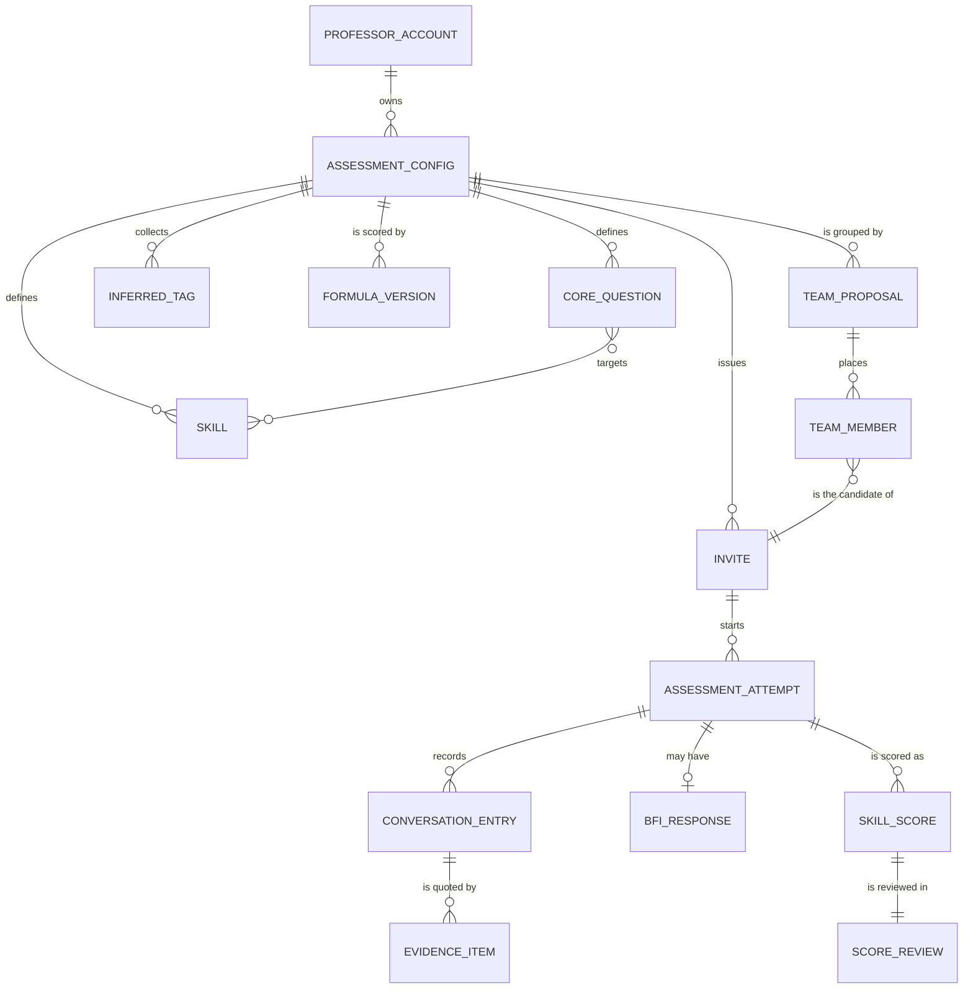

# Architecture Overview

This document summarizes the system architecture for the **Evidence-First Skill Assessment Platform** defined in [`docs/discovery-canvas.md`](./discovery-canvas.md) and the decisions in [`docs/decisions/index.md`](./decisions/index.md).

## 1. Monorepo Layout

```text
nifty/
├── backend/              # Java 21, Spring Boot 4.x, Spring AI 2.0, Timefold Solver, Flyway, PostgreSQL
├── frontend/             # Vue 3.5 (stable), TypeScript, Vite 8, Pinia, Vue Router, TanStack Query, Tailwind v4, ECharts
├── openspec/             # Shared Kiro-style spec-driven source of truth (specs/, changes/, config.yaml)
├── docs/                 # Product vision, architecture, workflow, decisions, and AI harness setup guide
├── .agents/              # Canonical scoped rules & shared skills
├── .claude/              # Claude Code agent roles, tested Node .mjs hooks, permissions, skill symlinks
├── .kiro/                # Thin Kiro IDE / Kiro Crew steering bridge (points to AGENTS.md & openspec/)
├── .githooks/            # Cross-agent & human portable Git hooks (pre-commit secrets, commit-msg, pre-push gate)
├── .github/              # CI workflows, PR template, and declarative GitHub Rulesets
├── scripts/              # Automation scripts (e.g., apply-github-rulesets.sh)
├── docker-compose.yml    # Local full-stack orchestration (db + backend + frontend)
└── .env.example          # Environment variable contract (never commit .env)
```

## 2. Two-View Product Architecture

MVP has two roles (Decision 1.15). The professor does all review work.

1. **Assessment View (Role: `CANDIDATE`):**
   - The candidate signs in with a personal invite link (Decision 1.17). The candidate answers each question, and the interviewer reply streams back over SSE (Decision 1.11). A countdown shows the time left for each question. There is no pause (Decision 2.14). An optional BFI-10 form follows the last core question (Decision 4.3).
   - The candidate sees no scores during the interview. The Results Page opens when the results are released (Decision 2.10).
2. **Ranking View (Role: `PROFESSOR`):**
   - This view is the control plane. It has the assessment form (Interviewer Studio, Decision 2.17), Skills & Tags taxonomy, formula presets, and the Skills Matrix heatmap. It also has the Evidence Drawer, the "Needs attention" review queue and the full conversation log. The Audit Log, the Cohort Gap Overview and the Timefold Team Builder complete it.

> **Core Invariant:** Configuration controls the **interviewer**, the scoring pipeline, and the team-formation pipeline. The system cannot extract evidence that it never collected.

## 3. Dual-Agent Evidence Pipeline

Two LLM agents never share context (Decision 1.12). Agent 1 (interviewer) has no rubric, level description or score. Agent 2 (evaluator) runs only after the attempt commits, and reads only the ledger and the rubric. Deterministic Java does every number.

```mermaid
flowchart LR
    CFG["Published config v&lt;n&gt;<br/>(professor form)"] --> INT
    INT["1. Agent 1: Interviewer<br/>(rubric-blind, streamed)"] -->|append every message| LED[("Conversation ledger<br/>append-only")]
    LED -->|AttemptCompletedEvent<br/>AFTER_COMMIT| EXT["2. Agent 2: Evaluator<br/>(ledger + hidden rubric)"]
    EXT --> VER["3. Quote Verifier (Java)"]
    VER --> SCO["4. Scorer (formula preset + 2-run judge)"]
    SCO --> CONF["5. Confidence per (question, skill) (Java)"]
    CONF --> GATE{"6. Release gate (Java)<br/>thresholds, coverage, flags"}
    GATE -->|all pass| AUTO["auto_released"]
    GATE -->|any fail| REV["Professor review"]
    AUTO --> AGG["7. Fit, coverage, matrix (SQL)"]
    REV --> AGG
    AGG --> BAL["8. Team Balancer (Timefold)"]
    BAL --> REV2["9. Team Approval (Professor)"]
```



| Step | Executor | Non-Negotiable Rule |
|---|---|---|
| 1. Interviewer | Agent 1, ki:connect NRW via Spring AI `ChatClient`, streamed (Decisions 1.11, 1.13) | A published config snapshot drives it. Its context holds the vision, core questions, target skill names and the current conversation only. It stays on topic, reveals no answer or score, does not judge the person, and keeps its role. |
| 2. Evaluator | Agent 2, ki:connect NRW (`https://chat.kiconnect.nrw/api/v1`). Models: `OpenAI GPT OSS 120B`, `Qwen 3.8 27B`, `Mistral Small 4 119B` | It starts from `@TransactionalEventListener(phase = AFTER_COMMIT)`. It returns schema-validated evidence items (quote, entry reference, skill, suggested level, rationale). It **never produces totals or scores**. Timed-out questions and BFI-10 data never reach it. |
| 3. Quote Verifier | Deterministic Java | Every quote must appear word-for-word in the referenced ledger entry. It **discards unverified quotes**. |
| 4. Scorer | Formula preset (Decision 2.19) + 2-run LLM judge | Missing verified evidence gives **`N/A`** (never `0` or `1`). A timed-out question gives `N/A` for all its skills. |
| 5. Confidence | Deterministic Java | One confidence per (question, skill) from measurable signals (Decision 2.11). It **never** uses LLM self-report. |
| 6. Release gate | Deterministic Java + professor | All scores at or above their question's threshold, coverage at or above the minimum, and no flag → `auto_released`. Otherwise the attempt waits in the professor's queue (Decision 2.10). An override needs a reason and writes `audit_log`. |
| 7. Totals & Cohort Gaps | Deterministic SQL | Only released scores of each candidate's latest attempt count (Decision 2.13). Fit and coverage show separately. |
| 8. Team Balancer | Timefold Solver | Team size and soft-constraint weights come from the config (Decision 2.18). The BFI-10 balance constraint applies when BFI-10 is on (Decision 4.3). Mode B parses text in a fresh LLM context, and the professor approves the constraints. |
| 9. Team Approval | Professor | A human publishes the teams. |

### Interview Request Flow

| Request | Response | Rule |
|---|---|---|
| `POST /api/v1/assessment/sessions` | SSE: greeting and question 1 with `expiresAt` | `409` when the attempts are used up |
| `POST /api/v1/assessment/sessions/{id}/answers` | SSE: follow-up or next question with `expiresAt`, or `done` | After `expiresAt`: `timedOut = true`, question `N/A`. After `expiresAt` + grace: `409`. Under the minimum time: `pasteSuspected = true`. |
| `GET /api/v1/assessment/sessions/{id}` | Session state from the ledger | Resumes after a page refresh |
| `POST /api/v1/assessment/sessions/{id}/bfi10` | `204` | Only when BFI-10 is on, after the last core question |

The server stores `expiresAt` when it asks a question. The browser counts down and submits the current text at zero. On every request, the service first closes questions whose deadline plus the grace period lies in the past.

## 4. Conversation Ledger & Transcript Contract

The ledger is the table `conversation_entry` (owner: `assessment`). The system appends one row for each candidate answer and each interviewer message, with a server timestamp. A Flyway trigger rejects `UPDATE`. It rejects `DELETE` unless the assessment deletion service set `SET LOCAL nifty.allow_purge = 'on'` (Decision 4.4). Columns: `id`, `attempt_id`, `seq`, `author` (`interviewer | candidate`), `core_question_id`, `origin`, `content`, `target_skills`, `created_at`, `expires_at`, `timed_out`, `paste_suspected`.

`assessment-transcript/v1` is the export format, built from the ledger. The system exports it as `*.transcript.json`.

- **Format identifier:** `"format": "assessment-transcript/v1"`
- **Top-level fields:** `format`, `transcriptId`, `candidateId`, `configVersion`, `attempt`, `startedAt`, `entries[]`, `evidence[]`
- **Entry (`entries[]`):** `entryId`, `turn`, `question` (`text`, `origin`: `core | follow_up | invented`, `coreQuestionId`, `weight`, `targetSkills[]`, `askedAt`, `expiresAt`), `answer` (`text`, `submittedAt`, `durationSec`, `timedOut`, `pasteSuspected`), `metadata` (`inferredTags[]` with `status: approved | pending | rejected`, `promptedTerms[]`, `unpromptedTerms[]`).
- **Evidence (`evidence[]`):** `evidenceId`, `entryId`, `skill`, `quote`, `quoteVerified` (`boolean`), `suggestedLevel` (`0..4`), `judgeRuns` (`int[]`), `rationale`.

### Cross-Layer Enum & State Lock-In Table

All backend Java enums, PostgreSQL columns, OpenAPI schemas, and frontend TypeScript union types MUST match these exact wire literals:

| Entity / Field | Exact Allowed Literals | Transitions / Computed-vs-Stored | Owner |
|---|---|---|---|
| `Role` | `PROFESSOR`, `CANDIDATE` | Stored per account or invite. It is the Spring Security authority boundary. A new role is one enum value plus rules in `SecurityConfig` (Decision 1.15). | `auth` |
| `config.status` | `DRAFT`, `PUBLISHED` | `DRAFT -> PUBLISHED` by the professor only. A published version never changes. | `studio` |
| `attempt.status` | `IN_PROGRESS`, `BFI10`, `COMPLETED` | `IN_PROGRESS -> BFI10 -> COMPLETED`, or `IN_PROGRESS -> COMPLETED` when BFI-10 is off | `assessment` |
| `entry.author` | `interviewer`, `candidate` | Stored, immutable | `assessment` |
| `question.origin` | `core`, `follow_up`, `invented` | Stored, immutable | `assessment` |
| `inferredTag.status` | `pending`, `approved`, `rejected` | Only the professor moves `pending -> approved \| rejected`. The evidence pipeline proposes tags through the `studio` service (Decision 1.16). | `studio` |
| `score` (`N/A` wire format) | `value: number (0..4) \| null`, `status: "SCORED" \| "N/A"` | Computed in Java/SQL for each (question, skill). `null` + `"N/A"` when there is no verified quote or the question timed out (NEVER `0` or `1`). Excluded from fit. | `evidence` |
| `reviewStatus` | `pending`, `flagged`, `auto_released`, `approved`, `overridden` | `pending -> auto_released` when the release gate passes. `pending \| flagged -> approved \| overridden` by the professor. `auto_released -> overridden` by the professor. `flagged` blocks bulk-approve. `overridden` needs a reason and an `audit_log` row. | `matrix` |

## 5. Domain Model

Each entity belongs to one slice (see [Feature Slice Map](#feature-slice-map)). Other slices read it through that slice's service, never through its repository.



| Entity | Slice | Key fields |
|---|---|---|
| `PROFESSOR_ACCOUNT` | `auth` | `id`, `email`, `password_hash`, `role` |
| `INVITE` | `auth` | `id`, `config_id`, `candidate_ref`, `token_hash`, `revoked` |
| `ASSESSMENT_CONFIG` | `studio` | `id`, `version`, `status`, `vision`, `min_coverage`, `max_attempts`, `bfi10_enabled`, `team_size`, `constraint_weights`, `invented_questions` |
| `SKILL` | `studio` | `id`, `config_id`, `name`, `weight` |
| `CORE_QUESTION` | `studio` | `id`, `config_id`, `text`, `weight`, `confidence_threshold`, `min_time_sec`, `max_time_sec`, `follow_up_limit` |
| `INFERRED_TAG` | `studio` | `id`, `config_id`, `name`, `status`, `merged_into` |
| `ASSESSMENT_ATTEMPT` | `assessment` | `id`, `invite_id`, `config_version`, `attempt_no`, `status`, `started_at`, `completed_at` |
| `CONVERSATION_ENTRY` | `assessment` | §4 ledger columns |
| `BFI_RESPONSE` | `assessment` | `attempt_id`, `item_1..item_10` (1–5), five trait means |
| `EVIDENCE_ITEM` | `evidence` | `id`, `entry_id`, `skill_id`, `quote`, `quote_verified`, `suggested_level`, `judge_runs`, `rationale` |
| `SKILL_SCORE` | `evidence` | `id`, `attempt_id`, `core_question_id`, `skill_id`, `value`, `status`, `confidence`, `formula_version` |
| `FORMULA_VERSION` | `formula` | `id`, `config_id`, `version`, `preset`, `weights` |
| `SCORE_REVIEW` | `matrix` | `score_id`, `review_status`, `override_value`, `reason`, `reviewed_at` |
| `TEAM_PROPOSAL` / `TEAM_MEMBER` | `teams` | `id`, `config_id`, `status` (`DRAFT \| PUBLISHED`), `team_no`, `invite_id` |
| `AUDIT_LOG` | `audit` | `V1__init.sql` columns. Written only through `AuditService`. |

- **Session state machine:** `ASSESSMENT_ATTEMPT.status` plus the ledger hold the whole interview state. The `assessment` service checks question order, the follow-up limit and every deadline in Java. It answers `409` for an input that the state does not allow.
- **Fetching:** `open-in-view` is off. Repositories load associations with `JOIN FETCH` or entity graphs, never lazily in a controller.

## 6. Runtime Topology (Docker Compose)

| Service | Port (default) | Notes |
|---|---|---|
| `db` (PostgreSQL 17 Alpine) | `5432` | Persistent volume `postgres_data`. The healthcheck uses `pg_isready`. |
| `backend` (Spring Boot 4 / Java 21) | `8080` | It depends on healthy `db`. It runs Flyway migrations on startup. It exposes `/actuator/health`, `/api/**`, and `/v3/api-docs`. |
| `frontend` (Vue 3.5 / Vite 8 / Nginx) | `5173` (dev) / `3000` (Docker) | It proxies `/api` and `/actuator` requests to `backend`. |

## Feature Slice Map

The backend is package-by-feature (Decision 1.10). Rules and enforcement are in [`.agents/rules/backend-java.md`](../.agents/rules/backend-java.md) §9. Each slice is a coarse product capability, so each teammate or agent works in one folder (Decision 1.16). Each slice maps to one backend package `de.fhdortmund.nifty.<package>`, with `web/`, `service/` and `repository/` layers as needed. Cross-cutting code lives in `shared/{config,exception}`. The [backlog](feature_backlog.md) reserves each slice's Flyway number.

| OpenSpec spec | Backend package | Frontend views | Owns |
|---|---|---|---|
| `auth-access` | `auth` | `views/auth/` | professor accounts, invite links, sign-in |
| — (cross-cutting) | `audit` | — | `AuditLog` entity, `AuditService` (the only writer of `audit_log`) |
| `interviewer-studio` | `studio` | `views/studio/` | assessment form, config versions, skills, inferred tags |
| `assessment-chat` | `assessment` | `views/assessment/` | attempts, conversation ledger, BFI-10 |
| `evidence-pipeline` | `evidence` | — (backend only) | evaluator, quote verifier, (question, skill) scores, confidence |
| `formula-engine` | `formula` | `views/ranking/` (formula presets) | formula versions |
| `skills-matrix-review` | `matrix` | `views/ranking/` | release gate, review queue, overrides |
| `team-builder` | `teams` | `views/teams/` | Timefold solver, proposals, team approval |
| `candidate-results` | `results` | `views/assessment/` (results page) | read model over released scores, log and traits |
