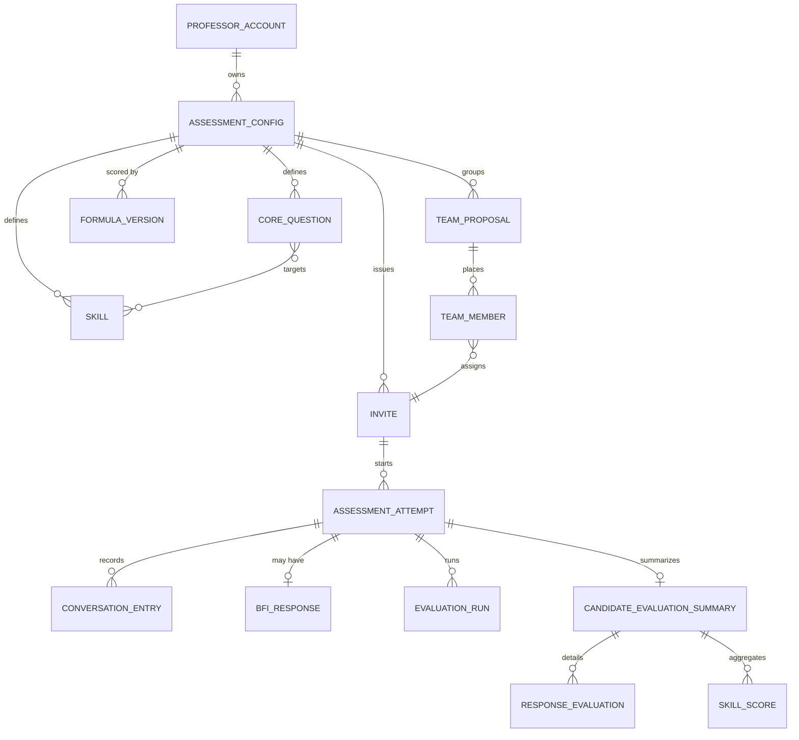

# Architecture Overview

This document summarizes the system architecture for the **Evidence-First Skill Assessment Platform** defined in [`docs/discovery-canvas.md`](./discovery-canvas.md) and [`docs/decisions/index.md`](./decisions/index.md).

## 1. Monorepo Layout

```text
nifty/
├── backend/              # Java 21, Spring Boot 4.x, Spring AI 2.0, Flyway, PostgreSQL
├── frontend/             # Vue 3.5 (stable), TypeScript, Vite 8, Pinia, Vue Router, TanStack Query, Tailwind v4, PrimeVue, ECharts
├── openspec/             # Shared spec-driven source of truth (specs/, changes/, config.yaml)
├── docs/                 # Product vision, architecture, API, decisions, AI logs, and runnable team tickets
├── .agents/              # Canonical scoped rules & shared skills
├── .claude/              # Claude Code agent roles, tested Node .mjs hooks, permissions, skill symlinks
├── .kiro/                # Thin Kiro IDE / Kiro Crew steering bridge (points to AGENTS.md & openspec/)
├── .githooks/            # Cross-agent & human portable Git hooks (pre-commit secrets, commit-msg, pre-push gate)
├── .github/              # CI workflows, PR template, and declarative GitHub Rulesets
├── scripts/              # Automation scripts (check-setup, forge, record-decision)
├── docker-compose.yml    # Local full-stack orchestration (db + backend + frontend)
└── .env.example          # Environment variable contract (never commit .env)
```

## 2. Two-View Product Architecture

MVP has two roles (Decision 1.15). The professor does all configuration, review, and team-approval work.

1. **Assessment View (Role: `CANDIDATE`):**
   - The candidate signs in with a personal invite link (Decision 1.17).
   - For `HARD_SKILLS` or `COMBINED` assessments, the candidate answers each core question while the interviewer reply streams over SSE (Decision 1.11). A countdown shows time left with no pause (Decision 2.14).
   - When BFI-10 is on, a fixed 10-item personality step runs after the last core question (Decision 4.3). In `SOFT_SKILLS`-only mode (`0` core questions and `bfi10Enabled = true`), the session opens straight on BFI-10 (Decision 2.23).
   - The candidate sees no scores during the interview. The Results Page opens when results are released (Decision 2.10).
2. **Ranking View (Role: `PROFESSOR`):**
   - This view is the control plane. Professors draft an assessment in browser `localStorage` and submit it once to create an immutable `PUBLISHED` configuration (Decision 2.21).
   - It also hosts invite generation, prompt preview, the Skills Matrix heatmap, the Evidence Drawer, the "Needs attention" queue, full conversation logs, the Audit Log, the Cohort Gap Overview, and the Team Builder.

> **Core Invariant:** Configuration controls the **interviewer**, the evaluation pipeline, and team formation. The system cannot extract evidence that it never collected.

## 3. Dual-Agent Evidence Pipeline

Two LLM agents never share context (Decision 1.12). `ContextCreationService` (`context`) is the sole prompt builder for both agents (Decision 1.18). Agent 1 (interviewer) never receives rubrics, level descriptions, weights, or scores. Agent 2 (evaluator) runs asynchronously after commit and reads only the ledger and hidden rubric. Deterministic Java computes every number.

```mermaid
flowchart LR
    CFG["Immutable config v1<br/>(studio)"] -->|"InterviewerView (no rubric)"| CTX1["ContextCreationService<br/>Agent 1 prompt + sanitizer"]
    CTX1 --> INT["1. Agent 1: Interviewer<br/>(rubric-blind, SSE stream)"]
    INT -->|append every message| LED[("Conversation ledger<br/>append-only")]
    LED -->|AttemptCompletedEvent<br/>AFTER_COMMIT| CTX2["ContextCreationService<br/>Agent 2 per-(entry, skill) prompt"]
    CFG -->|"EvaluatorView (hidden rubric)"| CTX2
    CTX2 --> EXT["2. Agent 2: 2-Run Judge<br/>(fresh context per pair)"]
    EXT --> VER["3. Quote Verifier (Java)"]
    VER --> CONF["4. Confidence per (entry, skill) (Java)"]
    CONF --> SCO["5. Formula B Scorer (Java)<br/>question weights + D2 cap + N/A"]
    SCO --> GATE{"6. Release gate (Java)<br/>thresholds, coverage, flags"}
    GATE -->|all pass| AUTO["auto_released"]
    GATE -->|any fail| REV["Professor review"]
    AUTO --> AGG["7. Fit, coverage, matrix (SQL)"]
    REV --> AGG
    AGG --> BAL["8. Seeded SA Team Optimizer (Java)"]
    BAL --> REV2["9. Team Approval (Professor)"]
```



| Step | Executor | Non-Negotiable Rule |
|---|---|---|
| 1. Context & Interviewer | `context` + `assessment` (Agent 1 via ki:connect NRW, streamed, Decisions 1.11, 1.13, 1.18) | `ContextCreationService` builds the rubric-blind prompt from `InterviewerView`, sanitizes candidate text, and returns `injectionSuspected` (Decision 2.24). Agent 1 stays on topic, reveals no answer or score, does not judge the person, and keeps its role. |
| 2. Evaluator Judge | `context` + `evaluation` (Agent 2 via ki:connect NRW, `OpenAI GPT OSS 120B`, `Qwen 3.8 27B`, `Mistral Small 4 119B`) | Starts from `@TransactionalEventListener(phase = AFTER_COMMIT)` on `AttemptCompletedEvent`. Runs two independent fresh-context calls per `(entryId, skillId)` using `EvaluatorView` rubrics (`0..4` ascending). Blank timed-out entries and BFI-10 data never reach Agent 2; timed-out answers with text reach it normally (Decision 2.20). Agent 2 returns one JSON object per `(entryId, skillId)` (level, quote, rationale, optional suggestion); a parser validates it and code computes every number (Decision 2.25). |
| 3. Quote Verifier | Deterministic Java (`evaluation`, zero Streams) | Every quote must appear word-for-word in the referenced ledger entry (`>= 8` chars). Unverified quotes are discarded. |
| 4. Confidence | Deterministic Java (`evaluation`, zero Streams) | Computes `0..1` confidence per (question, skill) score from evidence count, quote verification ratio, judge agreement, question origin, answer length, and prompted/unprompted terms (Decision 2.11, REQ-EP-03). Never uses LLM self-report. |
| 5. Formula B Scorer | Deterministic Java (`evaluation`, zero Streams) | Question-weighted mean (`SKILL` has no weight; follow-ups inherit `1.0` core question weight; multi-skill answers apply the full question weight capped per entry at `0.50`, Decision 2.22). Missing verified evidence yields `N/A` (never `0` or `1`). `fit` is the unweighted mean across `SCORED` skills; `coverage` is weighted over answered core questions (Decision 2.12). |
| 6. Release Gate | Deterministic Java + professor (`evaluation`) | All `SCORED` items at or above their core question's threshold, coverage at or above `min_coverage`, and zero `pasteSuspected` or `injectionSuspected` flags produce `auto_released`. Otherwise the attempt waits in the professor's queue (Decisions 2.10, 2.24). Overrides require a reason and write `audit_log` through `AuditService`. |
| 7. Totals & Cohort Gaps | Deterministic SQL (`evaluation`) | Only released scores of each candidate's latest completed attempt count (Decision 2.13). Fit and coverage show separately. |
| 8. Team Optimizer | Seeded Java Simulated Annealing + 2-opt (`teams`, Decision 1.20) | Partitions candidates into balanced team sizes (`floor(N/G)` and `ceil(N/G)`) minimizing `alpha * inter_team_imbalance - (1 - alpha) * intra_team_diversity` across `HARD_SKILLS`, `SOFT_SKILLS`, and `COMBINED` modes. Excludes `N/A` skills per candidate gracefully without rejecting cohorts or coercing to `0` or `1`. |
| 9. Team Approval | Professor (`teams`) | A human publishes the final teams. |

### Interview Request Flow

| Request | Response | Rule |
|---|---|---|
| `POST /api/v1/assessment/sessions` | SSE: greeting and question 1 with `expiresAt` (or JSON state for `SOFT_SKILLS`-only) | `409` when `max_attempts` is reached |
| `POST /api/v1/assessment/sessions/{id}/answers` | SSE: follow-up or next question with `expiresAt`, or `done` | After `expiresAt` within grace: `timedOut = true`, evaluated if non-blank (Decision 2.20). After `expiresAt` + grace: `409`, recorded timed out with no text. Under `min_time_sec` or above character-velocity ceiling: `pasteSuspected = true`. Injection match: `injectionSuspected = true` (Decision 2.24). |
| `GET /api/v1/assessment/sessions/{id}` | Session state from the ledger | Resumes after a page refresh |
| `POST /api/v1/assessment/sessions/{id}/bfi10` | `204` | Only when `bfi10Enabled = true` and `status = BFI10` |

## 4. Conversation Ledger & Transcript Contract

The ledger is `conversation_entry` (owner: `assessment`). The system appends one row per candidate answer and per interviewer reply with server timestamps. A Flyway trigger rejects `UPDATE` and rejects `DELETE` unless the deletion transaction set `SET LOCAL nifty.allow_purge = 'on'` (Decision 4.4).

Columns: `id` (`UUID`), `attempt_id`, `seq`, `author` (`interviewer | candidate`), `core_question_id`, `origin`, `content`, `target_skills` (`JSONB`), `created_at`, `expires_at`, `timed_out`, `paste_suspected`, `injection_suspected`.

`assessment-transcript/v1` is built from the ledger and exported as `*.transcript.json` through `GET /api/v1/ranking/transcripts/{attemptId}` (`PROFESSOR` only, Decision 1.19).

- **Format identifier:** `"format": "assessment-transcript/v1"`
- **Top-level fields:** `format`, `transcriptId`, `candidateId`, `configId`, `configVersion`, `attempt`, `startedAt`, `entries[]`, `evidence[]`
- **Entry (`entries[]`):** `entryId`, `turn`, `question` (`text`, `origin`: `core | follow_up | invented`, `coreQuestionId`, `weight`, `targetSkills[]`, `askedAt`, `expiresAt`), `answer` (`text`, `submittedAt`, `durationSec`, `timedOut`, `pasteSuspected`, `injectionSuspected`), `metadata` (`promptedTerms[]`, `unpromptedTerms[]`).
- **Evidence (`evidence[]`):** `evidenceId`, `entryId`, `skillId`, `skillName`, `quote`, `quoteVerified`, `suggestedLevel` (`0..4`), `judgeRuns` (`int[]`), `rationale`.

### Cross-Layer Enum & State Lock-In Table

All backend Java enums, PostgreSQL columns, OpenAPI schemas, and frontend TypeScript union types MUST match these exact wire literals:

| Entity / Field | Exact Allowed Literals | Transitions / Computed-vs-Stored | Owner |
|---|---|---|---|
| `Role` | `PROFESSOR`, `CANDIDATE` | Stored per account or invite. Spring Security boundary (Decision 1.15). | `auth` |
| `config.status` | `PUBLISHED` | Created immutable on one-shot submit (`version = 1`, Decision 2.21). | `studio` |
| `groupingMode` | `HARD_SKILLS`, `SOFT_SKILLS`, `COMBINED` | Stored on `assessment_config` (Decision 2.23). | `studio` / `teams` |
| `softPreset` | `ENGINEERING_DEFAULT`, `EQUAL_WEIGHTS`, `CUSTOM` | Stored on `assessment_config` (Decision 2.23). | `studio` / `teams` |
| `attempt.status` | `IN_PROGRESS`, `BFI10`, `COMPLETED` | `IN_PROGRESS -> BFI10 -> COMPLETED`, `IN_PROGRESS -> COMPLETED`, or `BFI10 -> COMPLETED` (`SOFT_SKILLS`-only). | `assessment` |
| `entry.author` | `interviewer`, `candidate` | Stored, immutable. | `assessment` |
| `question.origin` | `core`, `follow_up`, `invented` | Stored, immutable. | `assessment` |
| `evaluationRun.status` | `QUEUED`, `RUNNING`, `COMPLETED`, `FAILED` | Async job lifecycle in `evaluation`. | `evaluation` |
| `score` (`N/A` wire format) | `value: number (0..4) \| null`, `status: "SCORED" \| "N/A"` | Computed in Java/SQL. `null` + `"N/A"` when zero verified quotes exist (never `0` or `1`). Excluded from `fit`. | `evaluation` |
| `reviewStatus` | `pending`, `flagged`, `auto_released`, `approved`, `overridden` | `pending -> flagged` when a flag rule fires (REQ-SM-01). `pending -> auto_released` when release gate passes. `pending \| flagged -> approved \| overridden` by professor. `auto_released -> overridden` by professor. `flagged` blocks bulk-approve. `overridden` requires reason + `audit_log` row. | `evaluation` |

## 5. Domain Model (`UUID` Primary & Foreign Keys — Decision 1.19)

Each entity belongs to one slice and lives strictly inside `<slice>/repository/` (Decision 1.10, `ArchitectureRules.java`). Other slices read it only through that slice's public `@Service` methods returning Java `record` DTOs.



| Entity | Slice | Migration | Key Fields (all IDs `UUID`) |
|---|---|---|---|
| `AUDIT_LOG` | `audit` | `V1` | Exception to the UUID rule: merged `V1` keeps `id BIGSERIAL` and stores `entity_id` as `VARCHAR` (UUID text). `id`, `actor_id`, `actor_role`, `entity_type`, `entity_id`, `action`, `old_value`, `new_value`, `reason`, `created_at`. Written only through `AuditService`. |
| `PROFESSOR_ACCOUNT` | `auth` | `V2` | `id`, `email`, `password_hash`, `role` (`PROFESSOR`) |
| `ASSESSMENT_CONFIG` | `studio` | `V3` | `id`, `professor_id`, `title`, `vision`, `min_coverage` (`0..1`), `max_attempts` (`>= 1`), `invented_questions`, `bfi10_enabled`, `team_size`, `grouping_mode`, `soft_preset`, `combined_hard_weight`, `alpha`, `constraint_weights` (`JSONB`), `status` (`PUBLISHED`), `version` (`1`), `idempotency_key` (`UNIQUE`), `created_at` |
| `SKILL` | `studio` | `V3` | `id`, `config_id`, `name`, `rubric_levels` (`JSONB` array of 5 strings `0..4`). No `weight` column (Decision 2.22). |
| `CORE_QUESTION` | `studio` | `V3` | `id`, `config_id`, `position`, `text`, `weight` (`> 0`), `confidence_threshold` (`0..1`), `min_time_sec`, `max_time_sec`, `follow_up_limit` (`0..3`) |
| `CORE_QUESTION_SKILL` | `studio` | `V3` | `core_question_id`, `skill_id` |
| `INVITE` | `auth` | `V4` | `id`, `config_id`, `candidate_ref`, `token_hash`, `revoked`, `created_at` |
| `ASSESSMENT_ATTEMPT` | `assessment` | `V6` | `id`, `invite_id`, `config_id`, `config_version`, `attempt_no`, `status`, `started_at`, `completed_at` |
| `CONVERSATION_ENTRY` | `assessment` | `V6` | §4 ledger columns (`id`, `attempt_id`, `seq`, ..., `timed_out`, `paste_suspected`, `injection_suspected`) |
| `BFI_RESPONSE` | `assessment` | `V6` | `attempt_id`, `item_1..item_10` (`1..5`), `conscientiousness`, `agreeableness`, `neuroticism`, `extraversion`, `openness` (`1.0..5.0` means) |
| `FORMULA_VERSION` | `evaluation` | `V7` | `id`, `config_id`, `version_number`, `formula_preset` (`WEIGHTED_MEAN`), `max_entry_skill_weight_share` (`0.50`), `question_weights_json`, `created_by`, `created_at` |
| `EVALUATION_RUN` | `evaluation` | `V7` | `id`, `attempt_id`, `config_id`, `formula_version_id`, `context_template_version`, `status`, `idempotency_key` (`UNIQUE`), `attempt_count`, `error_message`, `started_at`, `completed_at` |
| `CANDIDATE_EVALUATION_SUMMARY` | `evaluation` | `V7` | `id`, `attempt_id` (`UNIQUE`), `config_id`, `invite_id`, `formula_version_id`, `latest_run_id`, `evaluation_status`, `fit_score`, `coverage`, `flagged_count`, `release_status` (`pending \| flagged \| auto_released \| approved \| overridden`), `released_at` |
| `RESPONSE_EVALUATION` | `evaluation` | `V7` | `id`, `evaluation_run_id`, `summary_id`, `entry_id`, `core_question_id`, `skill_id`, `question_origin`, `question_weight`, `run1_level`, `run2_level`, `run1_quote`, `run2_quote`, `quote_verified`, `verified_quote`, `ai_rationale`, `ai_level`, `calculated_confidence`, `flag_reasons`, `review_status`, `effective_level`, `overridden_by`, `override_reason`, `reviewed_at` |
| `SKILL_SCORE` | `evaluation` | `V7` | `id`, `summary_id`, `formula_version_id`, `skill_id`, `status` (`SCORED \| N/A`), `score`, `avg_confidence`, `verified_evidence_count`, `review_status` |
| `TEAM_PROPOSAL` / `TEAM_MEMBER` | `teams` | `V8` | `id`, `config_id`, `status` (`DRAFT \| PUBLISHED`), `num_teams`, `grouping_mode`, `alpha`, `seed`, `cost_metrics` (`JSONB`), `created_at`; `team_member(proposal_id, team_no, invite_id)` |

- **Fetching:** `open-in-view` is off. Repositories load associations with `JOIN FETCH` or entity graphs, never lazily in a controller.
- **GDPR Deletion (Decision 4.4):** `DELETE /api/v1/ranking/studio/configs/{id}` publishes `AssessmentDeletedEvent(configId, actorId)`. Each slice with candidate or config rows listens in the same transaction, sets `SET LOCAL nifty.allow_purge = 'on'` where mutation triggers exist, deletes its rows for `configId`, and `audit` records one deletion entry without candidate PII.

## 6. Runtime Topology (Docker Compose)

| Service | Port (default) | Notes |
|---|---|---|
| `db` (PostgreSQL 17 Alpine) | `5432` | Persistent volume `postgres_data`. Healthcheck uses `pg_isready`. |
| `backend` (Spring Boot 4 / Java 21) | `8080` | Depends on healthy `db`. Runs Flyway migrations on startup. Exposes `/actuator/health`, `/api/**`, and `/v3/api-docs`. |
| `frontend` (Vue 3.5 / Vite 8 / Nginx) | `5173` (dev) / `3000` (Docker) | Proxies `/api` and `/actuator` requests to `backend`. |

## Feature Slice Map (7 Slices — Decision 1.18)

The backend uses package-by-feature (Decision 1.10), enforced by `ArchitectureTest`. Each slice maps to one package `de.fhdortmund.nifty.<package>` with only the `{web, service, repository}` layers it needs. All `@Entity` classes live in `repository/`. Cross-cutting code lives in `shared/{config,exception}`.

| Spec(s) | Backend Package | Frontend Views | Flyway | Owns |
|---|---|---|---|---|
| `auth-access` | `auth` | `views/auth/` | `V2`, `V4` | Professor accounts, sign-in, candidate invite links, scope checks |
| — (cross-cutting) | `audit` | — | `V1` (existing) | `AuditLog` entity and public `AuditService` (sole writer of `audit_log`) |
| `interviewer-studio` | `studio` | `views/studio/` | `V3` | One-shot immutable assessment config, skills + hidden `0..4` rubrics, core questions, `StudioQueryService` views, GDPR delete trigger |
| `context-creation` | `context` | — (backend only) | — (stateless) | Sole prompt builder for Agent 1 (rubric-blind) and Agent 2 (hidden rubric), `PromptSanitizer`, `InjectionDetector`, `PROFESSOR` preview endpoint |
| `assessment-chat` | `assessment` | `views/assessment/` (chat + BFI-10) | `V6` | Attempts, SSE interview streaming, append-only ledger, server timers, `pasteSuspected`/`injectionSuspected`, single-source BFI-10 scoring |
| `evidence-pipeline`, `formula-engine`, `skills-matrix-review`, `candidate-results` | `evaluation` | `views/ranking/`, `views/assessment/` (results) | `V7` | Async 2-run judge, quote verifier, confidence, Formula B scorer, release gate, review/override queue, SQL cohort gaps, transcript export, candidate results read API |
| `team-builder` | `teams` | `views/teams/` | `V8` | Seeded Java Simulated Annealing team optimizer, drag-and-drop recalculation, draft/publish workflow |

> Flyway `V5` stays unused/reserved to keep `V6__assessment.sql` stable across teammate branches.

### Backend Test Base and Contract Placeholders

- **Test database:** every Spring test that needs a database extends `de.fhdortmund.nifty.PostgresContainerBase`. The class starts one `postgres:17-alpine` container for the whole test run. Flyway applies `V1` on that container. The tests use no H2, because H2 cannot run JSONB or the immutability triggers.
- **Contract stubs:** each shared interface, record and enum of `docs/tickets/00-parallel-waves-and-contracts.md` §3 exists in its owner package. Enums carry `@JsonValue` with the JSON and database literal.
- **Placeholders:** each of the 6 shared interfaces has one `<Interface>Placeholder` `@Service` in the same package. Every placeholder method throws `UnsupportedOperationException`. The owner deletes the placeholder when the real bean lands.
- **Sessions and bootstrap (`auth-accounts`):** sign-in creates a server HTTP session with an `HttpOnly`, `SameSite=Lax` cookie (`NIFTY_SESSION_COOKIE_SECURE=false` for local HTTP dev) and SPA CSRF (`XSRF-TOKEN` cookie, `X-XSRF-TOKEN` header, Decision 1.23). `ProfessorBootstrap` creates one `PROFESSOR` account at startup when `NIFTY_BOOTSTRAP_PROFESSOR_EMAIL` and `NIFTY_BOOTSTRAP_PROFESSOR_PASSWORD` are set and no account has that email (Decision 1.24). `AuthContextServiceImpl` replaces `AuthContextServicePlaceholder`.
- **Real beans:** `AuditService` is real (`audit-log-service`). `AuditServiceImpl` writes one `audit_log` row in the transaction of the caller. `AuditLogEntity` is `@Immutable`, and `AuditLogRepository` has no update or delete method.
- **Assessment (`assessment-chat`):** `AssessmentQueryServiceImpl` replaces `AssessmentQueryServicePlaceholder`. `AttemptService` writes each step of an attempt in one short transaction under a row lock. `AssessmentSessionService` then streams the interviewer reply outside any transaction. `AttemptExpiryScheduler` closes expired questions every 15 s (`nifty.assessment.expiry-sweep-cron`).
- **Shared errors and events:** `FieldValidationException` (`400` with `errors[]`) is in `shared/exception`. `AttemptCompletedEvent` and `AssessmentDeletedEvent` are in `shared/config`.

## Frontend Structure (`frontend-foundation`)

Each feature owns one folder under `frontend/src/views/<feature>/`: `auth`, `studio`, `assessment`, `ranking` and `teams`. Each folder has one `routes.ts` that exports a `RouteRecordRaw[]`. `router/index.ts` spreads the five arrays. A ticket changes only the `routes.ts` of its own folder.

| Path | Purpose |
|---|---|
| `src/api/client.ts` | `apiFetch<T>()` throws `ApiProblem` (`status`, `title`, `detail`, `errors[]`) on `application/problem+json` and sends `X-XSRF-TOKEN` on state-changing requests. `postSse()` reads an SSE stream from a `POST` with the same CSRF header. `postJsonOrSse()` returns JSON or SSE events, for the assessment start. |
| `src/views/assessment/` | `AssessmentChatView.vue` (`/assessment`): streamed interview, countdown to the server `expiresAt` with auto-submit at zero, 4000-character answer box. `Bfi10Form.vue`: the 10 BFI-10 items. `ResultsView.vue` belongs to `evaluation`. |
| `src/stores/auth.ts` | Pinia session store (`me`, `fetchMe`, `login`, `logout`) backed by `/api/v1/auth/**`. |
| `src/views/auth/` | `SignInView.vue` (`/sign-in`) and `guard.ts` (`/ranking/*` needs `PROFESSOR`, `/assessment/*` needs `CANDIDATE`). |
| `src/style.css` | The design tokens as Tailwind `@theme` variables. |
| `src/theme/preset.ts` | The one PrimeVue preset. It maps the `@theme` variables (Decision 1.14). |
| `src/components/` | Shared components. `ScoreBadge` shows `<level>/4 · <label>` or a hatched `N/A · not enough evidence`. It never shows `N/A` as `0`. |
| `src/test/echarts-mock.ts` | Replaces `vue-echarts` in every Vitest test, because jsdom has no canvas. |

Run the tests with `cd frontend && npm run test`. Vitest uses `jsdom` and finds each `*.test.ts` next to its code. Both CI files run `npm run test` after `npm run lint`.
