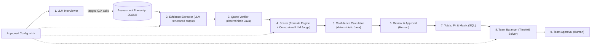

# Architecture Overview

This document summarizes the system architecture for the **Evidence-First Skill Assessment Platform** defined in [`docs/discovery-canvas.md`](./discovery-canvas.md).

## 1. Monorepo Layout

```text
nifty/
├── backend/              # Java 21, Spring Boot 4.x, Spring AI 2.0, Timefold Solver, Flyway, PostgreSQL
├── frontend/             # Vue 3.5 (stable), TypeScript, Vite 8, Pinia, Vue Router, TanStack Query, Tailwind v4, ECharts
├── openspec/             # Shared Kiro-style spec-driven source of truth (specs/, changes/, config.yaml)
├── docs/                 # Product vision, architecture, workflow, decisions, and AI harness setup guide
├── .agents/              # Canonical scoped rules & shared skills
├── .claude/              # Claude Code agent roles, tested Node .mjs hooks, permissions, skill symlinks
├── .kiro/                # Thin Kiro IDE / Kiro Crew steering bridge (points to AGENTS.md & openspec/)
├── .githooks/            # Cross-agent & human portable Git hooks (pre-commit secrets, commit-msg, pre-push gate)
├── .github/              # CI workflows, PR template, and declarative GitHub Rulesets
├── scripts/              # Automation scripts (e.g., apply-github-rulesets.sh)
├── docker-compose.yml    # Local full-stack orchestration (db + backend + frontend)
└── .env.example          # Environment variable contract (never commit .env)
```

## 2. Two-View Product Architecture

1. **Assessment View (Candidate — Role: `CANDIDATE`):**
   - The candidate joins through an invite link and completes a streaming SSE conversational assessment. The candidate sees core-question progress (no scores show mid-interview). The candidate sees the explainable Results Page only after human approval.
2. **Ranking View (Professor / Reviewer — Role: `PROFESSOR` / `REVIEWER`):**
   - This view is the core control plane. It has Interviewer Studio (versioned config), Skills & Tags taxonomy, Weights & Formula editor (what-if preview), and Skills Matrix heatmap. It also has Evidence Drawer, Confidence-bounded Approval Queue & Audit Log, Cohort Gap Overview, and Timefold Team Builder.

> **Core Invariant:** Configuration controls the **interviewer**, the scoring pipeline, and the team-formation pipeline. The system cannot extract evidence that it never collected.

## 3. Nine-Step Evidence-First Pipeline

Every score and team placement follows the deterministic, human-gated pipeline from `discovery-canvas.md` §9:



| Step | Executor | Non-Negotiable Rule |
|---|---|---|
| 1. Interviewer | LLM (Spring AI 2.0) | An immutable approved config snapshot drives it. It tags each Q/A with `origin` (`core \| follow_up \| invented`) and target skills. |
| 2. Extractor | LLM Evaluator via **ki:connect NRW / FH AI** (`https://chat.kiconnect.nrw/api/v1`, Aachen/NRW) | It produces schema-validated structured output with evidence items (quote, entry reference, skill, tags, suggested level). Models: `OpenAI GPT OSS 120B`, `Qwen 3.8 27B`, `Mistral Small 4 119B`. It **never produces final scores.** |
| 3. Quote Verifier | Deterministic Java code | It verifies that every quote appears word-for-word in the referenced transcript entry. It **discards unverified quotes**. |
| 4. Scorer | Sandboxed Formula Engine (SpEL `SimpleEvaluationContext`) + 2-run LLM Judge (**ki:connect NRW**) | Missing verified evidence gives **`N/A`** (never `0` or `1`). The scorer excludes it from the fit numerator and denominator. |
| 5. Confidence | Deterministic Java code | The code computes confidence from measurable signals (evidence count, quote verification ratio, judge agreement, question origin, prompted vs. unprompted terms). It **never** uses LLM self-reported confidence. |
| 6. Review & Approval | Human (`PROFESSOR` / `REVIEWER`) | A human must review each flagged item (below lower confidence bound, team-deciding, or high self-assessment mismatch) individually. An override requires a reason and writes an audit log entry. |
| 7. Totals & Cohort Gaps | Deterministic SQL | The LLM **never** calculates totals, rankings, or cohort statistics. The system always computes and shows fit and coverage separately. |
| 8. Team Balancer | Timefold Solver (Java) | Mode A uses presets. In Mode B, a fresh-context LLM parses text to constraints, a human approves them, and Timefold solves. Mode C is an optional stretch: a fresh-context LLM makes a proposal and a deterministic validator verifies it. |
| 9. Team Approval | Human (`PROFESSOR`) | A human gives final sign-off before the system publishes results and teams (EU AI Act Annex III / GDPR readiness). |

## 4. Assessment Transcript Contract (`assessment-transcript/v1`)

The system stores transcripts as **PostgreSQL `JSONB`** and validates them against JSON Schema. It can export them as `*.transcript.json`.

- **Format identifier:** `"format": "assessment-transcript/v1"`
- **Top-level fields:** `format`, `transcriptId`, `candidateId`, `configVersion`, `startedAt`, `entries[]`, `evidence[]`
- **Entry (`entries[]`):** `entryId`, `turn`, `question` (`text`, `origin`: `core | follow_up | invented`, `coreQuestionId`, `weight`, `targetSkills[]`), `answer` (`text`, `durationSec`), `metadata` (`inferredTags[]` with `status: approved | pending | rejected`, `promptedTerms[]`, `unpromptedTerms[]`).
- **Evidence (`evidence[]`):** `evidenceId`, `entryId`, `skill`, `quote`, `quoteVerified` (`boolean`), `suggestedLevel` (`0..4`), `judgeRuns` (`int[]`), `rationale`.

### Cross-Layer Enum & State Lock-In Table

All backend Java enums, PostgreSQL columns/JSONB payloads, OpenAPI schemas, and frontend TypeScript union types MUST match these exact wire literals:

| Entity / Field | Exact Allowed Literals | Transitions / Computed-vs-Stored | Owner |
|---|---|---|---|
| `Role` | `PROFESSOR`, `REVIEWER`, `CANDIDATE` | Stored per account/session. It is the Spring Security authority boundary (2 views: Ranking vs. Assessment). | Backend Security & Frontend Router |
| `question.origin` | `core`, `follow_up`, `invented` | Immutable once recorded in `assessment-transcript/v1` `entries[]` | Interviewer Studio & Assessment Chat |
| `inferredTag.status` | `pending`, `approved`, `rejected` | Stored. Only human review moves `pending -> approved \| rejected` (D1). | Evidence Pipeline & Skills Matrix Review |
| `score` (`N/A` wire format) | `value: number (0..4) \| null`, `status: "SCORED" \| "N/A"` | The system computes it deterministically in Java/SQL. It sets `null` + `"N/A"` when there are zero verified quotes (NEVER `0` or `1`). It excludes the score from fit. | Formula Engine & Frontend Matrix |
| `reviewStatus` | `pending`, `flagged`, `approved`, `overridden` | Stored. Allowed transition: `pending \| flagged -> approved \| overridden`. `flagged` blocks bulk-approve. `overridden` requires reason + immutable `audit_log` row. | Skills Matrix Review & Candidate Results |

## 5. Runtime Topology (Docker Compose)

| Service | Port (default) | Notes |
|---|---|---|
| `db` (PostgreSQL 17 Alpine) | `5432` | Persistent volume `postgres_data`. The healthcheck uses `pg_isready`. |
| `backend` (Spring Boot 4 / Java 21) | `8080` | It depends on healthy `db`. It runs Flyway migrations on startup. It exposes `/actuator/health`, `/api/**`, and `/v3/api-docs`. |
| `frontend` (Vue 3.5 / Vite 8 / Nginx) | `5173` (dev) / `3000` (Docker) | It proxies `/api` and `/actuator` requests to `backend`. |

## Feature Slice Map

The backend is package-by-feature (Decision 1.10). Rules and enforcement are in [`.agents/rules/backend-java.md`](../.agents/rules/backend-java.md) §8. Each OpenSpec spec maps to one backend package `de.fhdortmund.nifty.<package>`. Each package has `web/`, `service/` and `repository/` layers as needed. Cross-cutting code lives in `shared/{config,exception}`.

| OpenSpec spec | Backend package | Frontend views |
|---|---|---|
| `interviewer-studio` | `studio` | `views/studio/` |
| `assessment-chat` | `assessment` | `views/assessment/` |
| `evidence-pipeline` | `evidence` | — (backend only) |
| `formula-engine` | `formula` | `views/ranking/` (formula editor) |
| `skills-matrix-review` | `matrix` | `views/ranking/` |
| `team-builder` | `teams` | `views/teams/` |
| `candidate-results` | `results` | `views/assessment/` (results page) |
