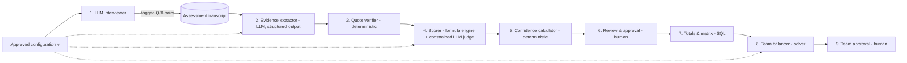

# Evidence-First Skill Assessment Platform

> **Working title:** TBD (ideas: *Evident*, *Proofline*)
> **Course:** Innovation Driven Software Engineering, FH Dortmund (block week)
> **Team size:** 5
> **Status:** Discovery draft v1. Source document for Kiro specs.

---

## 1. Problem Statement

> **AI interviews can assess skills at scale, but professors and recruiters cannot trust or verify the scores. We need a system where every number links to evidence and a human approves it before anyone uses it.**

### 1.1 Background

At the start of the course, every student completed an LLM-run baseline assessment. A system prompt defined the interview flow, a 0–4 proficiency scale and a fixed scorecard plus JSON output. The lecturer then gave all the results to a paid LLM to rank students and suggest teams.

What went wrong:

- **Made-up numbers.** The model invented results and statistics for the cohort.
- **Links that were not there.** The model linked metrics across candidates where the data did not support a link.
- **Students disagreed with their profiles.** They had no way to see *why* they got a score.

The single-candidate output also had structural flaws, although its averages were right.

| Flaw | Example from a real scorecard | Consequence |
|---|---|---|
| No "insufficient evidence" state | "Not directly assessed" → scored **1 (Theoretical)** | Untested looks the same as weak |
| No confidence value | All scores look equally certain | Reviewer cannot prioritise |
| No link from score to evidence | Short summary only, no transcript reference | Nobody can verify the score |
| Different questions per candidate | One student got no Spring scenario. Another student got it. | Rankings across the cohort are not comparable |
| Level 4 rewards keywords | "Mentions `@Transactional`… unprompted" | Easy to game with AI help |

**Root cause:** the process gave the LLM jobs that need deterministic code (adding up, ranking, comparing across candidates). It also gave the LLM decisions that nobody could audit.

### 1.2 IRS Framing (from the lecture)

| | |
|---|---|
| **Issue** | Decision-makers cannot trust or verify AI-generated skill profiles. They also cannot trust or verify the rankings and teams that come from these profiles. |
| **Requirement** | Every score traces to evidence. The system shows missing evidence explicitly. Code calculates totals and team formation, and the results are reproducible. A human approves every score and configuration before anyone uses it. |
| **Solution** | An evidence-first pipeline. The LLM does conversation and extraction. Deterministic code does scoring, totals and team formation. A visual review layer lets the professor approve. |

### 1.3 Project Constraints

| Constraint | Source |
|---|---|
| Deliver a working product within the **one-week block week** | Lecturer |
| Use agentic harnesses, AI factories and human-in-the-loop agentic engineering | Lecturer |
| Mandatory stack: **Spring Boot** backend, **Vue.js** frontend, DB to be decided | Team / course |
| Must still make sense in **2026 and 2027**: current tooling, current regulation | Team |
| Builds on the course's self-assessment interview. What we do *with* it is the product | Course prompt |

### 1.4 Week Checklist (from lecture slides)

| Area | Item | Where it lives in this doc |
|---|---|---|
| Design Thinking (Confluence) | **Empathy Canvas:** candidate persona and HMW problem statement | §3–§5 (publish to Confluence) |
| Design Thinking (Confluence) | **Domain Vision:** pick assessment topic and unique UX features | §1.5, §8 |
| Discovery Canvas | 1. Empathy Map (Says / Thinks / Does / Feels) · 2. "How Might We…" · 3. Winning Assumptions | §4, §5, §6 |
| Local & cloud tooling | **Laptop ready:** Java 21 SDK, Maven, Docker Desktop and an IDE | §13 |
| Local & cloud tooling | **Team setup:** Git repo with protected `main`, Jira | §13, §14 |
| IRS framework ("Fast Code Against the Wrong Wall") | Issue → Requirement → Solution | §1.2 |

### 1.5 Domain Vision: Assessment Topic

- **Topic:** assessing **project-readiness competencies of software engineering students** across the course's domains: Git, CI/CD, Jira/Confluence, Design Thinking, HitL AI, Java and Spring Boot. Scenarios are conversational, not quizzes.
- **The two purposes come from the original baseline prompt:**
  1. **Find knowledge gaps across the cohort** so the lecturer can adjust introductory lectures (UX-12).
  2. **Standardised skill profiles** for balanced, complementary team formation (UX-05, UX-08).
- **Extensible:** the same engine can be configured for job postings (the recruiter scope, P4).

---

## 2. Market Landscape (summary)

| Category | Examples | What they do | Gap we target |
|---|---|---|---|
| Technical assessment & AI interviewers | HackerRank, CodeSignal (Interviewer Agents), HackerEarth, Codility, CoderPad | Coding sandboxes, AI-run screening interviews, rubric scorecards | Focus on coding tasks. Little on project or method skills. No team formation. |
| ATS / talent intelligence | Workday, Greenhouse, Lever, Eightfold | CV parsing, matching profiles to jobs | Match profiles but do not verify skills |
| One-way video interviews | HireVue, Spark Hire | Recorded answers, AI competency scores | Scores seen as too coarse for technical roles |
| Team formation in education | CATME Team-Maker | Survey plus algorithm to form student teams | Relies on self-assessment, which studies show is inconsistent |

**Trends that support this product**

- Skills-based hiring is now mainstream (≈70% of US employers per NACE 2026), yet only about a third of employers fully trust CVs.
- Humans still make most final decisions. Fully automated rejection is rare.
- AI-assisted cheating is common in remote technical assessments (Fabric found signs in ~38.5% of ~20k interviews). The industry answer is to redesign assessments (probe reasoning), not only to add surveillance.
- LLM-as-a-judge research: scores shift when the rubric order or format changes, and high consistency can coexist with strong bias.

**Regulatory context (key for 2027+)**

- **EU AI Act:** AI used for recruitment, candidate selection and *task allocation* is **high-risk** (Annex III). The Digital Omnibus on AI (Regulation (EU) 2026/1744, in force 27 July 2026) moved those obligations to **2 December 2027**. A product released in 2027 arrives just when these obligations apply. Human oversight, logging and explainability are therefore features, not overhead.
- **Mobley v. Workday (N.D. Cal.):** AI screening discrimination claims are proceeding, and the *vendor* can be held liable.
- **GDPR:** transcripts are personal data. Significant automated decisions require human involvement and an explanation.

---

## 3. Personas

> In this doc, "candidate" and "student" mean the same person. The professor is the **primary** user.

### P1: Dr. Jan Hoffmann, Professor / Lecturer *(primary)*

- Industry-based guest lecturer running a one-week project course with about 60 Master's students.
- Has to form 12 balanced teams of 5 on day 1 and explain the method to students.
- Uses AI daily. An LLM made up cohort statistics in front of the class. That moment was embarrassing.
- **Goal:** fair, complementary teams in under an hour, with reasoning he can defend.
- **Fear:** looking unprofessional because of a number he cannot explain.

### P2: Lena Petrova, Student / Candidate

- M.Sc. Computer Science student with a TypeScript/Node full-stack background. She is strong in LLM orchestration. She is just starting Java/Spring.
- She felt that her AI-generated profile undersold her strengths and mislabelled skills that nobody tested.
- **Goal:** be assessed fairly and join a team where she can contribute and learn.
- **Fear:** a black-box score that follows her around.

### P3: Tobias Krämer, Reviewer / Teaching Assistant

- Supports the professor. Reviews flagged scores and edge cases.
- **Goal:** resolve only the items that need a human, quickly, with the evidence in front of him.
- **Fear:** a review queue of 960 items with no way to sort it.

### P4: Sarah Lindqvist, Technical Recruiter *(future scope)*

- Recruiter at an IT consultancy. Configures interviews from job postings and compares candidates against a role spec.
- **Goal:** a trustworthy skill signal plus an audit trail for compliance.
- Not in the week-1 MVP. The architecture should support her without a rewrite.

---

## 4. Empathy Maps

### 4.1 P1: Professor

| **Says** | **Thinks** |
|---|---|
| "I used a paid model, this should have worked." | "If I can't explain a team assignment, I can't defend it." |
| "I need teams by tomorrow morning." | "Self-assessment surveys are mostly optimism." |
| "Show me *why* this student is a 4." | "I don't have time to read 60 transcripts." |
| "The students should know how they were evaluated." | "Am I allowed to use AI to evaluate students like this?" |

| **Does** | **Feels** |
|---|---|
| Writes a project vision and the competencies he needs | Embarrassed after the made-up results in class |
| Pastes results into an LLM and asks for teams | Pressed for time at the start of each block week |
| Verifies results by hand when something looks wrong | Curious, open to AI, but sceptical now |
| Adjusts teams manually after complaints | Responsible for students' grades and experience |

**Pains:** time pressure, unverifiable AI output, reading transcripts by hand, explaining decisions.
**Gains:** reproducible teams, evidence on demand, control over the evaluation logic, less admin.

### 4.2 P2: Student / Candidate

| **Says** | **Thinks** |
|---|---|
| "That score isn't accurate." | "It never even asked me about Spring." |
| "Why am I a 1 in something I wasn't tested on?" | "Should I use ChatGPT during the interview? Others probably do." |
| "I want to know what I'm being graded on." | "Will this profile end up in front of recruiters?" |

| **Does** | **Feels** |
|---|---|
| Answers a long interview, sometimes skipping a domain | Misjudged and powerless |
| Compares results with classmates | Anxious when others compare them |
| Over-explains in areas they are good at | Motivated when the questions match real work |

**Pains:** opaque scoring, untested skills scored low, no way to dispute.
**Gains:** a fair and explainable profile, a team that uses their strengths, a clear learning path.

### 4.3 P3: Reviewer / TA

| **Says** | **Thinks** |
|---|---|
| "Which of these actually need me?" | "If I approve everything, what's the point?" |
| "Where in the transcript did this come from?" | "Two students with the same answer got different scores?" |

| **Does** | **Feels** |
|---|---|
| Scans long lists and samples items to verify | Overwhelmed by volume |
| Re-reads transcripts for disputed scores | Unsure whether the system records overrides anywhere |

**Pains:** too many items, no prioritisation, evidence is hard to find.
**Gains:** a queue limited to flagged items, one-click evidence, an audit trail of decisions.

---

## 5. How Might We… (HMW)

1. **HMW** make every skill score traceable to the exact moment in the conversation that justifies it?
2. **HMW** let the professor shape what the interviewer asks without needing prompt-engineering skills?
3. **HMW** tell "not tested" apart from "tested and weak," so the system does not penalise candidates for gaps in the interview?
4. **HMW** keep candidate results comparable while still letting the interviewer adapt to each answer?
5. **HMW** make the evaluation formula visible and editable, for the professor during setup and for the candidate afterwards?
6. **HMW** focus human attention only on the decisions that are uncertain or high-impact?
7. **HMW** form complementary teams with reasoning a professor can defend in front of the class?
8. **HMW** make the assessment reward real understanding over keywords and AI-assisted answers?
9. **HMW** keep a human approving every score and configuration without creating review fatigue?

---

## 6. Winning Assumptions

What should let our solution beat the market. Each item has a quick test for the week.

| # | Assumption | How we test it in the block week |
|---|---|---|
| A1 | Professors will trust AI scores **if** each score opens to verified evidence. | Show the lecturer the skills matrix and evidence drawer. Ask him to find the reason for 3 scores in under 30 s. |
| A2 | An explicit **N/A + confidence** model produces fewer disputed profiles than a forced 0–4. | Re-score 5 real transcripts both ways. Ask the students which profile they agree with. |
| A3 | Professors want to **configure the interviewer themselves** (vision, core questions, toggles) rather than use a fixed prompt. | Lecturer builds one configuration in Interviewer Studio without help. |
| A4 | Deterministic team formation with reasoning beats LLM-generated teams on perceived fairness. | Compare solver teams vs. LLM teams on the same data. Count mistakes and invented facts. |
| A5 | Showing the formula to candidates after approval reduces complaints. | Candidate results page walkthrough with 2–3 classmates. |
| A6 | Confidence-bound flagging cuts review effort by more than 70% compared with reviewing everything. | Count flagged vs. total scores on the demo cohort. |

---

## 7. Product Vision: Two Views

```
┌────────────────────────────┐        ┌───────────────────────────────────────┐
│  ASSESSMENT VIEW           │        │  RANKING VIEW (professor / reviewer)  │
│  (candidate)               │        │                                       │
│                            │        │  • Interviewer Studio (configure)     │
│  • Join via invite link    │◄───────┤  • Skills & tags taxonomy             │
│  • Chat with LLM           │ config │  • Weights & formula editor           │
│    interviewer             │        │  • Confidence bounds                  │
│  • Progress on core        │        │  • Skills matrix                      │
│    questions               │───────►│  • Evidence drawer                    │
│  • Results page (after     │transcr.│  • Review & approval queue            │
│    approval only)          │        │  • Team builder                       │
└────────────────────────────┘        └───────────────────────────────────────┘
```

The **Ranking View is the core of the product.** It owns the configuration that drives the interviewer, the extractor, the scorer and the balancer. It is also where every human approval happens.

> **Key design rule:** the configuration controls the *interviewer as well*, not just the scoring steps. The system cannot extract evidence that it never collected.

---

## 8. Unique UX Features

### UX-01: Interviewer Studio
The professor configures how the LLM interviewer behaves:

- **Vision input:** project vision, team vision, job posting, or free-text requirements.
- **Core questions:** required questions every candidate must answer, each with a weight and linked skills/tags.
- **Behaviour toggles:**
  - *Follow-up questions* on/off (probing within a core question).
  - *Invented questions* on/off (the LLM may create new questions from the vision, skills and tags).
  - Turn budget and skill coverage targets.
- **Candidate list:** import (CSV) or invite links.
- **Preview:** run a test interview as a mock candidate before publishing.
- Nothing goes live until the professor **approves** the configuration (a versioned snapshot).

### UX-02: Skills & Tags Taxonomy
- The professor defines the **skills** (closed list) and the **tags** for calibration.
- The extractor may **suggest new tags** it finds in answers. Suggestions appear as pending chips. The professor accepts, merges (e.g., "containers" → "Docker") or rejects each one. Inferred tags never enter scoring without approval.

### UX-03: Weights & Formula Editor
- The professor sets weights **per core question** and **per skill** with sliders.
- Formula presets (weighted mean, minimum-coverage-gated, must-have skills) plus an **expression editor** for overrides. The editor allows only a fixed set of variables and functions.
- **Live preview:** shows how a change reorders sample candidates *before* the professor applies it (what-if).
- The system stores every formula version. Each score records which version produced it.
- The system **shows the formula to the candidate** on their results page after approval, never during the interview.

### UX-04: Confidence Bounds & Attention Flags
- The professor sets **lower and upper confidence bounds**.
- Scores below the lower bound, or other configured triggers, get a **red border or shadow** and go into a **"Needs attention"** lane.
- The professor can **bulk-approve** scores above the upper bound. The professor approves everything in between per candidate.
- **Review queue order** (most important first):
  1. Flagged by confidence bounds.
  2. Scores that **decide a team placement**, where changing the score would move the candidate to another team.
  3. Large **disagreement with the candidate's self-assessment** (from onboarding).
  4. Everything else.
- **Rubber-stamp detection:** the dashboard shows each reviewer's override rate and average time per review, so the "human in the loop" stays real.

### UX-05: Skills Matrix
- A heatmap of candidates × skills.
- Visual encoding: colour = level, **hatched = N/A (not enough evidence)**, red border = flagged, opacity = confidence.
- Sort and filter by overall fit, coverage, single skill or flag state.
- **Hover** → short summary. **Click** → evidence drawer. The matrix hides details until the user asks for them.

### UX-06: Evidence Drawer
- Shows one score step by step: **formula → weighted parts → evidence items → verified quotes**, each linked to its exact position in the transcript.
- Shows whether evidence came from a *core*, *follow-up* or *invented* question.
- Actions: **Approve**, **Override** (reason required), **Request re-probe**.

### UX-07: Approval Workflow & Audit Log
- The professor always gives the final approval for configuration, scores and teams.
- The professor can bulk-approve within bounds. The professor must approve flagged items one by one.
- The system logs every approval and override (who, what, when, why). This supports EU AI Act expectations for human oversight and logging.

### UX-08: Team Builder
- Visual team cards with balance indicators (skill coverage per domain, average strength, and so on).
- **Three modes:**
  - **A, Formula/solver:** the professor picks constraint presets (team size, one strong member per key domain, balanced averages).
  - **B, Text criteria → constraints:** the professor writes criteria in plain language. An LLM in a **fresh, empty context** turns them into solver constraints. The professor approves them. The solver computes the teams.
  - **C, LLM proposal (optional):** an LLM in a fresh context proposes teams from *computed* scores only. A **deterministic validator** verifies the proposal (the proposal assigns everyone exactly once, has the right team sizes, and has no invented candidates or scores). The system shows the proposal next to the solver result.
- Drag and drop to adjust. The balance indicators recalculate live.
- Click a team or member → **reasoning** (which constraints and scores drove the placement).

### UX-09: Candidate Assessment Chat
- Chat with progress on core questions (e.g., "3 of 6 topics covered"). The chat shows no scores during the interview.
- Responses stream in. The candidate can pause and resume.

### UX-10: Candidate Results Page (after approval)
- The candidate sees their own scores, linked evidence, confidence, the formula that the system used and the weights.
- **Dispute** button (MVP: mocked screen) sends the item to the reviewer queue.

### UX-11: Assessment Transcript Export
- The system can export every transcript in the documented Assessment Transcript format (§10), for audit, re-scoring or use by other tools.

### UX-12: Cohort Gap Overview
- SQL calculates the distribution of levels per skill across the cohort, the share of N/A, and the weakest domains. It uses **approved** scores only.
- Helps the lecturer decide what to cover in introductory lectures (purpose 1 of the original baseline prompt).
- Every bar opens to the candidates and evidence behind it. An LLM writes no cohort statistic. That is what failed in the original demo.

---

## 9. Pipeline Architecture



| Step | Who does it | Notes |
|---|---|---|
| 1. Interviewer | LLM | The configuration drives it. It labels each Q/A pair with question type and target skills. |
| 2. Extractor | LLM (structured output, schema-verified) | Produces evidence items: quote, Q/A reference, skill, tags, suggested level. **No final scores.** |
| 3. Quote verifier | Code | Rejects any quote that the transcript does not contain word-for-word |
| 4. Scorer | Formula engine (code) + LLM judge for level boundaries | Missing evidence → **N/A**, never 0 or 1 |
| 5. Confidence | Code | Uses measurable signals, not the LLM's own estimate (see §11.3) |
| 6. Review | Human | Ordered by flags and impact |
| 7. Totals | SQL | The LLM never calculates numbers. It may only write text around numbers that it receives. |
| 8. Balancer | Timefold Solver (Java) | Constraint-based, with explainable scores |
| 9. Team approval | Human | Final approval |

---

## 10. Assessment Transcript Format

**Decision:** we keep the "Assessment Transcript" concept, but use **JSON that a JSON Schema verifies** instead of a newly invented `.ast` syntax.

**Why not a custom format:**

- `.ast` already widely means "abstract syntax tree" and would confuse tools and readers.
- A new syntax needs its own parser, validator and editor support. That would take a week that we do not have.
- JSON maps directly to Jackson (Spring), TypeScript types, Postgres JSONB **and** LLM structured output.
- YAML is error-prone for LLMs to write (indentation, implicit type conversion).

**Convention:** file name `*.transcript.json`. The system stores it as JSONB in the DB and can export it as a file. The format identifier is `"format": "assessment-transcript/v1"`.

```json
{
  "format": "assessment-transcript/v1",
  "transcriptId": "tr_01J...",
  "candidateId": "cand_042",
  "configVersion": "cfg_7@v3",
  "startedAt": "2026-11-23T09:12:00Z",
  "entries": [
    {
      "entryId": "e_005",
      "turn": 5,
      "question": {
        "text": "Your push to main is rejected after a teammate merged. Walk me through what you do.",
        "origin": "core",
        "coreQuestionId": "cq_git_01",
        "weight": 1.5,
        "targetSkills": ["git_conflicts", "git_workflow"]
      },
      "answer": {
        "text": "I'd fetch first, then rebase my feature branch onto origin/main ...",
        "durationSec": 74
      },
      "metadata": {
        "inferredTags": [
          { "tag": "rebase", "status": "approved" },
          { "tag": "force-push-risk", "status": "pending" }
        ],
        "promptedTerms": ["rebase"],
        "unpromptedTerms": ["force-with-lease"]
      }
    }
  ],
  "evidence": [
    {
      "evidenceId": "ev_019",
      "entryId": "e_005",
      "skill": "git_conflicts",
      "quote": "rebase my feature branch onto origin/main",
      "quoteVerified": true,
      "suggestedLevel": 3,
      "judgeRuns": [3, 3],
      "rationale": "Correct standard workflow; no mention of history-rewrite risks."
    }
  ]
}
```

`origin` is one of `core | follow_up | invented`. `promptedTerms` vs. `unpromptedTerms` lets a reader verify the "mentioned without being prompted" rule.

---

## 11. Scoring Model

### 11.1 Default skill score

For skill *s*, over verified evidence items *e* tagged with *s*:

$$
\text{score}(s) = \frac{\sum_e w_q(e)\cdot \text{level}(e)\cdot c(e)}{\sum_e w_q(e)\cdot c(e)}
$$

- *w_q(e)*: weight of the question the evidence came from. The professor sets it. Invented questions can default to a lower weight.
- *level(e)*: approved level 0–4.
- *c(e)*: evidence confidence.
- **No evidence → `N/A`.**

### 11.2 Candidate fit & coverage (shown separately)

$$
\text{fit} = \frac{\sum_{s \in \text{scored}} w_s \cdot \text{score}(s)}{\sum_{s \in \text{scored}} w_s}
\qquad
\text{coverage} = \frac{\sum_{s \in \text{scored}} w_s}{\sum_{s \in \text{all}} w_s}
$$

The system ranks by *fit* by default and filters by a minimum *coverage* that the professor sets. The system flags a candidate with low coverage. It does not quietly rank the candidate lower or higher.

### 11.3 Confidence (calculated, not self-reported)

LLM self-reported confidence is poorly calibrated. Confidence therefore comes from measurable signals:

| Signal | Example |
|---|---|
| Evidence count vs. target | 1 item = weak, 3+ = strong |
| Quote verification ratio | The system drops unverified quotes |
| Judge agreement | Two independent judge runs agree or disagree |
| Question origin | Core > follow-up > invented |
| Prompted vs. unprompted | Unprompted concepts count more toward Level 4 |

A documented function combines the signals into a 0–1 value. The professor's **bounds** (UX-04) apply to this value.

### 11.4 Formula overrides

- The system offers presets and an expression editor with **only approved variables and functions** (e.g., `score(s)`, `w(s)`, `coverage`, `min`, `max`, `if`).
- The server evaluates formulas in a sandboxed expression engine (e.g., SpEL with `SimpleEvaluationContext`), **never** as free-form code.
- The system versions formulas. The professor previews changes on sample candidates before applying them.

---

## 12. Design Decisions from Discussion

| # | Topic | Decision |
|---|---|---|
| D1 | Skills from answers | Inferred tags are **suggestions** that the professor approves into a controlled list. This prevents tag sprawl ("Docker" vs. "containers") and keeps calibration consistent. |
| D2 | One answer → several skills | Allowed, but each evidence item gets its own level and confidence. The default formula caps how much one Q/A pair can add per skill. |
| D3 | Question weights × skill weights | Both exist (§11). The evidence drawer shows each multiplication step. The professor sees exactly where a number came from. |
| D4 | Invented questions | Allowed via toggle. The system marks them `origin: invented`, gives them a lower default weight and can exclude them from cross-candidate ranking to keep comparability. |
| D5 | Turn budget vs. skill count | Core questions guarantee a minimum of coverage. Gaps show as N/A. A follow-up session is future scope. |
| D6 | Changing the configuration after interviews | Weight and formula changes recompute instantly. Adding skills or core questions creates a new version and marks affected candidates "incomplete." |
| D7 | Team formation by LLM | Only in a fresh context. Either it converts text into solver constraints (mode B) or its proposal must pass a deterministic validator (mode C). The LLM is a parser and proposer, never the final authority. |
| D8 | Transcript format | JSON + JSON Schema (`assessment-transcript/v1`), not a custom `.ast` syntax. |
| D9 | "Ranking" wording | The internal view name stays "Ranking View." The UI emphasises fit against the spec and teams over a single global leaderboard. This lowers legal risk, which matters for the recruiter scope. |
| D10 | Candidate transparency | Formula, weights and own evidence are visible **after** approval. A dispute path exists (mocked in MVP). |

---

## 13. Tech Stack

| Layer | Choice | Status |
|---|---|---|
| Backend | Java 21, **Spring Boot 4.x**, Spring Security (2 roles), Spring Web (SSE for chat streaming) | Decided |
| AI integration | **Spring AI 2.0** (ChatClient, provider-native structured output, self-correcting schema validation, MCP SDK 2.0) | Recommended |
| Team formation | **Timefold Solver** (Java constraint solver) | Recommended |
| Formula engine | SpEL in a restricted context (or a small custom expression parser) | Recommended |
| Database | **PostgreSQL** (relational tables for scores and evidence, JSONB for transcripts, pgvector optional later), Flyway migrations | Recommended (DB was TBD) |
| Frontend | **Vue 3.5 + TypeScript + Vite 8**, Vue Router, Pinia, TanStack Query (Vue) | Decided (Vue) / recommended (rest) |
| UI components | PrimeVue *or* shadcn-vue + Tailwind CSS v4 | To decide in team |
| Visualisation | Apache ECharts (vue-echarts) for the skills-matrix heatmap and team balance charts | Recommended |
| API contract | OpenAPI via springdoc, generated TypeScript client | Recommended (fits spec-driven agents) |
| Testing | JUnit 5, Mockito, Testcontainers (Postgres), recorded LLM responses replayed in tests | Recommended |
| CI | Git repo with protected `main`, pipeline running build + tests + container image | From course checklist |
| Project management & docs | **Jira** (backlog, stories linked to Kiro specs), **Confluence** (Design Thinking artefacts: empathy canvas, domain vision) | From course checklist |
| Local tooling | Java 21 SDK, Maven, Docker Desktop, IDE | From course checklist |

**Frontend version note:** Vue 3.6 (Vapor Mode) is still a release candidate as of November 2026. Stay on 3.5 stable. The team can try Vapor later on specific components only.

**LLM provider:** TBD. Prefer EU-hosted endpoints (transcripts are personal data).

---

## 14. Development Approach: Spec- and Agent-Driven

- **Kiro IDE:** spec-driven development. Each feature becomes a `.kiro/specs/<feature>/` folder with `requirements.md` (user stories + acceptance criteria in EARS notation), `design.md` and `tasks.md`. Humans review and approve each phase.
- **Kiro Crew:** orchestrates multiple agents over longer, multi-session work. It reuses the existing `.kiro` configuration (steering files, skills, custom agents).
- **Harness (team-owned):** steering files with coding rules, custom skills, hooks (lint, tests on save), and review gates. Human-in-the-loop applies to our *own* development too. Agents propose. Humans approve merges.

### 14.1 Suggested spec breakdown

1. `interviewer-studio`: configuration, core questions, toggles, versioning
2. `assessment-chat`: candidate chat, streaming, transcript capture
3. `evidence-pipeline`: extractor, quote verifier, scorer, confidence
4. `formula-engine`: weights, presets, expression editor, what-if
5. `skills-matrix-review`: matrix, evidence drawer, approval queue, audit log, cohort gap overview
6. `team-builder`: solver modes A/B/(C), reasoning, drag and drop
7. `candidate-results`: results page, mocked dispute

### 14.2 Seed requirements (EARS)

- **WHEN** the professor publishes a configuration **THE SYSTEM SHALL** store an immutable, versioned snapshot and link all subsequent interviews to it.
- **WHILE** an interview is in progress **THE SYSTEM SHALL** ask every core question in the active configuration before ending the session, unless the turn budget is exhausted.
- **WHERE** "invented questions" is disabled **THE SYSTEM SHALL** only ask core questions and follow-ups on them.
- **WHEN** the extractor returns an evidence item **THE SYSTEM SHALL** verify that its quote appears word-for-word in the referenced transcript entry and discard it if it does not.
- **IF** a skill has no verified evidence **THEN THE SYSTEM SHALL** record its score as `N/A` and exclude it from fit calculations.
- **WHEN** a score's confidence is below the configured lower bound **THE SYSTEM SHALL** mark it as flagged and place it in the "Needs attention" queue.
- **THE SYSTEM SHALL** calculate all totals, rankings and team-balance metrics in code, and **SHALL NOT** take any numerical value from LLM output without validation.
- **WHEN** the professor overrides a score **THE SYSTEM SHALL** require a reason and write an audit log entry with user, timestamp, old value and new value.
- **WHEN** an LLM-proposed team assignment is received **THE SYSTEM SHALL** validate that every candidate is assigned exactly once and that team sizes match the constraints before displaying it.
- **WHEN** the professor approves a candidate's scores **THE SYSTEM SHALL** make the candidate's own scores, evidence, weights and formula visible on their results page.

---

## 15. Risks & Mitigations

| Risk | Mitigation |
|---|---|
| Config changes after interviews invalidate evidence | Versioned configs. Block or flag structural changes (D6). |
| Adaptive questions break comparability | Required core questions. The system marks invented questions and weights them down (D4). |
| Extractor invents quotes | Word-for-word quote verification (pipeline step 3) |
| LLM judge bias at level boundaries | Two judge runs and agreement as a confidence signal. Fixed rubric order. Human review. |
| Keyword gaming / AI-assisted answers | Track prompted vs. unprompted terms. Ask "why there?" follow-ups. Reward reasoning that fits the scenario. |
| No ground truth for accuracy | Small set of human-rated transcripts. Report agreement between humans and the pipeline. |
| N/A distorts rankings | Fit and coverage shown separately. Minimum coverage filter. |
| Review fatigue / rubber-stamping | Confidence bounds, bulk-approve within bounds, track override rate |
| Unexplainable teams | Timefold constraint scores as reasoning. The system always verifies LLM output. |
| Legal / ethical (high-risk AI) | Human approval required, audit log, candidate transparency, no single global leaderboard in the recruiter scope |
| LLM latency and cost | Background pipeline jobs with status in the UI. Stream the chat. |
| Non-deterministic tests | Record and replay LLM responses |
| Thin demo data | 15–25 synthetic candidates from deliberately varied personas, clearly labelled as synthetic |

---

## 16. MVP Scope (Block Week)

**In scope**

- Interviewer Studio (vision, core questions, toggles, skills/tags, candidate list, approval)
- Assessment chat with streaming and transcript capture
- Evidence extraction + quote verification + N/A + calculated confidence
- Weights + formula presets (expression editor if time allows) + what-if preview
- Skills matrix + evidence drawer + flags + prioritised approval queue + audit log
- Cohort gap overview (UX-12)
- Team builder modes A and B with reasoning
- Candidate results page

**Out of scope / mocked**

- Recruiter persona and job-posting mode
- Overrides feeding back into prompts
- Dispute flow (UI mock only)
- Multi-session interviews
- Team builder mode C (stretch goal)
- **Candidate-owned "skill passport"**: a verified, shareable profile the candidate controls (future direction)

**Development basics (day 1)**

- Every laptop ready: Java 21 SDK, Maven, Docker Desktop, IDE (plus Kiro IDE and Kiro Crew)
- Git repo with protected `main`, Jira project, Confluence space for the Design Thinking artefacts

**Suggested split (5 people)**

| Area | People | Owns |
|---|---|---|
| Ranking View: Studio, formula, review UI | 1 | UX-01–07 frontend |
| Ranking View: evidence pipeline & scoring | 1 | Extractor, verifier, scorer, confidence |
| Ranking View: team builder | 1 | Timefold integration, UX-08 |
| Assessment View: chat UI + results page | 1 | UX-09, UX-10 |
| Assessment View: interviewer backend + harness/CI | 1 | Interviewer orchestration, SSE, Kiro harness, pipeline |

---

## 17. Open Questions

1. Which LLM provider and region? Budget per interview?
2. Do we keep the course's 16 sub-skills or cut to a smaller core list for the MVP?
3. Team size and constraints the lecturer actually uses (fixed 5? mixed backgrounds?)
4. Expression editor in the MVP, or presets only?
5. Do candidates see their results immediately after approval, or only after teams are published?
6. Data retention period for transcripts in the demo environment?

---

## Sources

- HackerEarth, *AI interviewers for software engineer screening* (2026). hackerearth.com/blog/ai-interviewers-for-software-engineer
- HackerEarth, *10 Best AI Recruiting Software for Technical Roles in 2026*. hackerearth.com/blog/10-best-ai-recruiting-software-for-technical-roles-in-2026
- HackerEarth, *AI Interview Agent vs One-Way Video Interview*. hackerearth.com/blog/ai-interview-agent-vs-one-way-video-interview
- CMU / MIT CSAIL / UIUC materials on CATME Team-Maker and self-assessment inconsistencies.
- JobDiva, *Why the Old Screening Playbook Is Failing Recruiters* (NACE Job Outlook 2026 figures), May 2026.
- HR Executive, *AI is devaluing resumes* (2026 Talent Acquisition Trends Study).
- People Matters / Resume Genius, *2026 Hiring Insights Report*.
- SHRM Labs, *When Candidates Can Fake Skills: Real-Time Assessment Design* (Fabric data), 2026.
- Li et al., *Evaluating Scoring Bias in LLM-as-a-Judge*, arXiv:2506.22316.
- *Reliability without Validity: A Systematic, Large-Scale Evaluation of LLM-as-a-Judge Models*, arXiv:2606.19544.
- DLA Piper, Gibson Dunn, Cooley, White & Case: EU AI Act Digital Omnibus analyses (Regulation (EU) 2026/1744, in force 27 July 2026).
- Bloomberg Law / Law360: *Mobley v. Workday*, N.D. Cal. No. 3:23-cv-00770 (June 2026 rulings).
- Spring, *Spring AI 2.0.0 GA Available Now* (June 2026) and *Self-Correcting Structured Output in Spring AI 2.0*.
- Vite, *Vite 8.0 is out!* (March 2026). Vue 3.6 release status: dev.to *New in Vue – November 2026*.
- Kiro docs, *Specs: Concepts* (EARS, requirements/design/tasks). InfoQ, *AWS Open Sources Kiro Crew* (Aug 2026).
- Course material: lecture slides (IRS framework, Async Homework & Week Checklist, 3-Step Discovery Canvas) and the baseline assessment system prompt.
