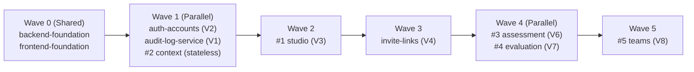

# Parallel Wave Map & Locked Inter-Service Contracts

> **Source of Truth:** Decisions `1.18–1.21` and `2.21–2.25`, `docs/architecture.md`, `docs/api.md`, `docs/feature_backlog.md`.
> Every teammate's AI agent reads these exact Java interfaces, record DTOs, events, and Flyway slots so all five slices compile together with zero contract drift.

## 1. Ownership & Non-Overlap Matrix

| Owner | Feature / Change | Backend Package | Frontend Folder | Flyway | Branch |
|---|---|---|---|---|---|
| Shared (Wave 0) | `backend-foundation` + `frontend-foundation` | `shared/`, `pom.xml` | `frontend/` shell | — | `feat/backend-foundation`, `feat/frontend-foundation` |
| **#1 Teammate R** (Wave 1/3) | `auth-accounts`, `invite-links` ([ticket 01](01-studio.md)) | `auth` | `views/auth/` | `V2`, `V4` | `feat/auth-accounts`, `feat/invite-links` |
| **#1 Teammate R** (Wave 1) | `audit-log-service` ([ticket 01](01-studio.md)) | `audit` | — | `V1` (existing) | `feat/audit-log-service` |
| **#1 Teammate R** | [`studio-assessment-creation`](01-studio.md) | `studio` | `views/studio/` | `V3__studio.sql` | `feat/studio-assessment-creation` |
| **#2 Teammate A** | [`context-creation`](02-context-creation.md) | `context` | — | — (stateless) | `feat/context-creation` |
| **#3 Teammate S** | [`assessment-chat`](03-assessment-chat.md) | `assessment` | `views/assessment/` (chat + BFI-10) | `V6__assessment.sql` | `feat/assessment-chat` |
| **#4 Teammate M** | [`evaluation-service`](04-evaluation.md) | `evaluation` | `views/ranking/`, `views/assessment/ResultsView.vue` | `V7__evaluation.sql` | `feat/evaluation-service` |
| **#5 Teammate C** | [`team-builder`](05-teams.md) | `teams` | `views/teams/` | `V8__teams.sql` | `feat/team-builder` |

> **Hard ArchUnit Rules (`ArchitectureRules.java`, Decision 1.10):**
> 1. Every `@Entity` and `JpaRepository`/`Repository` lives strictly inside `<slice>/repository/` (NEVER `<slice>/domain/`).
> 2. No slice may import another slice's `repository/` package. Cross-slice calls go strictly through public `@Service` interfaces returning Java `record` DTOs.
> 3. `shared/` never imports any feature slice. Use `shared/exception/FieldValidationException` for multi-field `400` RFC 9457 `ProblemDetail` errors.
> 4. Every PK and FK across every slice is `UUID` (Decision 1.19). Only the merged `V1` `audit_log` keeps `BIGSERIAL id` and stores `entity_id` as UUID text.
> 5. `V5` stays unused/reserved so `V6__assessment.sql` does not shift.
> 6. `repository/` never depends on `service/`. Entities store the §3 enum values as `String` columns (the JSON/DB literal). Map them to the enum in the service layer.

> **Shared conventions (all slices):**
> - **Placeholders:** US-BF-06 ships every §3 interface plus one placeholder `@Service` per interface that throws `UnsupportedOperationException`. `@SpringBootTest` contexts therefore start. Each owner deletes their placeholder when the real implementation lands. Deleted so far: `AuditServicePlaceholder` (`audit-log-service`), `AssessmentQueryServicePlaceholder` (`assessment-chat`). `AuditService` writes real rows.
> - **Tests on PostgreSQL:** US-BF-02 moves all Spring tests to Testcontainers through `de.fhdortmund.nifty.PostgresContainerBase`. H2 cannot run JSONB or the triggers. Extend that base class in `@DataJpaTest` and `@SpringBootTest` tests.
> - **`@WebMvcTest` security:** add `@Import(SecurityConfig.class)` so the `403` tests see the real path rules.
> - **`AssessmentDeletedEvent`:** listeners are synchronous `@EventListener` methods with `@Transactional(propagation = MANDATORY)`. They run in the deleting transaction, which holds `SET LOCAL nifty.allow_purge = 'on'`. This is the one exception to the AFTER_COMMIT rule. `AttemptCompletedEvent` stays `@TransactionalEventListener(phase = AFTER_COMMIT)`.
> - **`ChatClient`:** no slice defines a `@Bean ChatClient`. Each slice builds its own client from the injected `ChatClient.Builder` inside its service.
> - **`@EnableAsync` / `@EnableScheduling`:** a slice that needs one puts it on a `@Configuration` class in its own `service/` package, with a bounded executor.
> - **Foreign keys across slices:** store the foreign `UUID` without a database FK to a table of another slice (for example `professor_id`). Only rows inside the same slice use FKs.
> - **Shared files:** `docs/api.md`, `CHANGELOG.md`, `docs/feature_backlog.md`, `docs/feature_history.md` and `frontend/src/api/` change in several branches. Edit only your own section, run `git merge origin/dev` before the PR, and keep both sides on a conflict. Write the history entry with `PR/MR: pending` and fill it in after the PR opens.

## 2. Parallel Delivery Waves & Mocking Strategy



**Gate before handing out tickets 01–05:** Wave 0 must be merged on `dev`, including US-BF-06 (all §3 interfaces, records and enums as compile-only Java stubs) and US-FF-01 (Vitest and `npm run test`). Without the stubs, each teammate would write their own copy of the shared types, and the five branches would conflict.

**How everyone starts immediately without waiting idle:**
- **Wave 0** (`backend-foundation` with the US-BF-06 stubs, `frontend-foundation`) is merged on `dev` (2026-11-25). **Wave 1** (`auth-accounts`, `audit-log-service`) can run beside the teammates, because the stubs let them mock `AuthContextService` and `AuditService`.
- **#2 Teammate A (`context`)** has zero DB tables and can start immediately in Wave 1 (mock `AuditService` in unit tests).
- **#1 Teammate R (`studio`)** implements `StudioQueryService` behind the US-BF-06 stub. Teammates #3, #4 and #5 import the stub records directly and never copy them.
- **#3 Teammate S (`assessment`), #4 Teammate M (`evaluation`), and #5 Teammate C (`teams`)** can each begin all pure-JVM unit tests (`US-*-01`..`US-*-04`) immediately in parallel by mocking upstream `@Service` interfaces (`StudioQueryService`, `ContextCreationService`, `AssessmentQueryService`, `EvaluationQueryService`, `AuditService`) using the exact signatures below, then merge `origin/dev` once upstream waves merge. Each owner replaces the stub of their own interface with the real implementation.

## 3. Locked Java Interfaces, Record DTOs & Domain Events

### 3.1 Shared Events & Validation Exception (`de.fhdortmund.nifty.shared`)

```java
// shared/exception/FieldValidationException.java (mapped in GlobalExceptionHandler -> 400 ProblemDetail)
public record FieldErrorDetail(String field, String message, String code) {}
public class FieldValidationException extends RuntimeException {
    private final List<FieldErrorDetail> errors;
    public FieldValidationException(List<FieldErrorDetail> errors) { ... }
    public List<FieldErrorDetail> getErrors() { ... }
}

// shared/config/ (cross-slice Spring application events — zero imports from feature slices)
public record AttemptCompletedEvent(UUID attemptId, UUID configId, UUID inviteId) {}
public record AssessmentDeletedEvent(UUID configId, String actorId) {}
```

### 3.2 `audit` (`de.fhdortmund.nifty.audit.service`)

```java
public enum AuditActorRole { PROFESSOR, CANDIDATE, SYSTEM }

public interface AuditService {
    void record(
            String actorId,
            AuditActorRole actorRole,
            String entityType,    // e.g. "ASSESSMENT_CONFIG", "RESPONSE_EVALUATION", "ATTEMPT", "TEAM_PROPOSAL"
            UUID entityId,
            String action,        // e.g. "CONFIG_CREATED", "CONFIG_DELETED", "PROMPT_INJECTION_DETECTED", "SCORE_OVERRIDDEN", "TEAMS_PUBLISHED"
            String oldValue,      // nullable
            String newValue,      // nullable (never raw candidate PII)
            String reason         // nullable unless override
    );
}
```

### 3.3 `auth` (`de.fhdortmund.nifty.auth.service`)

```java
public interface AuthContextService {
    UUID currentProfessorId();
    CandidateSessionPrincipal currentCandidate(); // throws 403 if not CANDIDATE
}

public record CandidateSessionPrincipal(UUID inviteId, UUID configId, String candidateRef) {}
```

### 3.4 `studio` (`de.fhdortmund.nifty.studio.service`) — Exposed by #1 Teammate R

```java
public interface StudioQueryService {
    boolean exists(UUID configId);
    boolean ownedBy(UUID configId, UUID professorId); // added by studio-assessment-creation; used by invite-links
    InterviewerView interviewerView(UUID configId); // Throws DomainException(404) if missing
    EvaluatorView   evaluatorView(UUID configId);
    ScoringView     scoringView(UUID configId);
    TeamView        teamView(UUID configId);
}

// studio/service/view/ — typed enums. An enum whose JSON/DB literal differs from its name carries @JsonValue (EntryOrigin, ReleaseStatus, ScoreStatus: "follow_up", "auto_released", "N/A"). The others serialise as their names.
public enum GroupingMode { HARD_SKILLS, SOFT_SKILLS, COMBINED }
public enum SoftPreset { ENGINEERING_DEFAULT, EQUAL_WEIGHTS, CUSTOM }

// studio/service/view/ — STRICT RUBRIC GUARD: InterviewerView & InterviewerQuestion NEVER carry rubric/weight/threshold/coverage
public record InterviewerView(
        UUID configId,
        String configVersion,              // "v1" in records; the DB stores version INT 1
        String vision,
        int maxAttempts,
        boolean inventedQuestionsEnabled,
        boolean bfi10Enabled,
        GroupingMode groupingMode,
        List<InterviewerQuestion> questions // ordered by position (empty only for SOFT_SKILLS-only)
) {}

public record InterviewerQuestion(
        UUID coreQuestionId,
        int position,
        String text,
        int minTimeSec,
        int maxTimeSec,
        int followUpLimit,                 // 0..3
        List<UUID> targetSkillIds,
        List<String> targetSkillNames
) {}

public record EvaluatorView(
        UUID configId,
        List<EvaluatorSkill> skills,
        List<EvaluatorQuestion> questions
) {}

public record EvaluatorSkill(
        UUID skillId,
        String name,
        List<String> rubricLevels          // EXACT size 5, index 0..4 ascending (Decision 1.19)
) {}

public record EvaluatorQuestion(
        UUID coreQuestionId,
        String text,
        List<UUID> skillIds
) {}

public record ScoringView(
        UUID configId,
        BigDecimal minCoverage,            // 0.0000..1.0000
        List<ScoringQuestion> questions
) {}

public record ScoringQuestion(
        UUID coreQuestionId,
        BigDecimal weight,                 // > 0 (Decision 2.22: no SKILL.weight)
        BigDecimal confidenceThreshold,    // 0.0000..1.0000
        List<UUID> skillIds
) {}

public record TeamView(
        UUID configId,
        int teamSize,
        GroupingMode groupingMode,
        SoftPreset softPreset,
        BigDecimal combinedHardWeight,     // 0.0000..1.0000
        BigDecimal alpha,                  // 0.0000..1.0000
        Map<String, BigDecimal> constraintWeights,
        boolean bfi10Enabled
) {}
```

### 3.5 `context` (`de.fhdortmund.nifty.context.service`) — Exposed by #2 Teammate A

```java
public interface ContextCreationService {
    BuiltPromptContext buildInterviewerContext(InterviewerContextInput input);
    BuiltPromptContext buildJudgeContext(JudgeContextInput input);
    // Only context writes the PROMPT_INJECTION_DETECTED audit row (entityId = attemptId). assessment never audits it.
    SanitizationReport inspectCandidateInput(UUID attemptId, String rawCandidateText);
}

// context/service/dto/
public enum AgentRole { INTERVIEWER, EVALUATOR_JUDGE }
public record PromptMessage(String role, String content) {}
// Parse target of the evaluator judge JSON (REQ-EP-08, Decision 2.25). evaluation validates level 0..4.
public record JudgeEvaluationOutput(int level, String verbatimQuote, String rationale, String suggestion) {}
public record SanitizationReport(boolean injectionSuspected, List<String> matchedRuleIds, boolean truncated) {}
public record BuiltPromptContext(
        AgentRole agentRole,
        String templateVersion,
        String systemPrompt,
        List<PromptMessage> messages,
        String promptSha256,
        SanitizationReport sanitizationReport
) {}

// Compile-time rubric-blind Agent 1 input (ZERO rubric/weight/threshold/score/bfi fields)
public record InterviewerContextInput(
        UUID attemptId,
        String configVersion,
        String vision,
        List<String> targetSkillNames,
        CoreQuestionPromptView activeQuestion,
        int coreQuestionsRemaining,
        boolean inventedQuestionsEnabled,
        List<DialogueTurnView> priorTurns
) {}

public record CoreQuestionPromptView(
        UUID coreQuestionId,
        String questionText,
        List<String> targetSkillNames,
        int followUpLimit,
        int followUpsUsed
) {}

// String values: context must not import assessment (assessment calls context). author: "interviewer" | "candidate"; origin: "core" | "follow_up" | "invented"
public record DialogueTurnView(int seq, String author, String origin, String content) {}

// Agent 2 per-(entryId, skillId) fresh-context judge input (Decision 1.19, 2.20)
public record JudgeContextInput(
        UUID attemptId,
        UUID entryId,
        UUID skillId,
        String skillName,
        List<String> rubricLevels,         // exact size 5, index 0..4 ascending
        String questionText,
        String answerText,                 // non-blank only; blank entries skipped upstream
        boolean timedOut
) {}
```

### 3.6 `assessment` (`de.fhdortmund.nifty.assessment.service`) — Exposed by #3 Teammate S

```java
public enum EntryOrigin { CORE, FOLLOW_UP, INVENTED } // JSON and DB literals: core | follow_up | invented

public interface AssessmentQueryService {
    ImmutableTranscriptView getTranscriptForAttempt(UUID attemptId);           // zero BFI-10 data!
    Optional<UUID> getLatestCompletedAttemptId(UUID configId, UUID inviteId);
    List<StudentSoftSkillProfile> getSoftSkillProfilesForConfig(UUID configId); // latest completed attempt per invite
    Optional<StudentSoftSkillProfile> getSoftSkillProfileForAttempt(UUID attemptId);
}

public record ImmutableTranscriptView(
        UUID attemptId,
        UUID configId,
        UUID inviteId,
        String configVersion,
        int attemptNo,
        Instant startedAt,
        Instant completedAt,
        List<TranscriptEntryView> entries
) {}

// One entry = one question/answer pair. entryId is the ID of the candidate-answer row in conversation_entry.
public record TranscriptEntryView(
        UUID entryId,
        int seq,
        UUID coreQuestionId,
        EntryOrigin origin,
        String questionText,
        String answerText,                 // empty/null if unanswered after expiry
        List<UUID> targetSkillIds,
        Instant askedAt,
        Instant expiresAt,
        Instant submittedAt,
        long durationSec,
        boolean timedOut,
        boolean pasteSuspected,
        boolean injectionSuspected
) {}

public record StudentSoftSkillProfile(
        UUID inviteId,
        UUID attemptId,
        Map<String, Double> softSkillScores // already reverse-scored 1.0..5.0 means for:
                                            // "conscientiousness", "agreeableness", "neuroticism", "extraversion", "openness"
                                            // null when bfi10Enabled == false
) {}
```

### 3.7 `evaluation` (`de.fhdortmund.nifty.evaluation.service`) — Exposed by #4 Teammate M

```java
// JSON and DB literals are lower case: pending | flagged | auto_released | approved | overridden
public enum ReleaseStatus { PENDING, FLAGGED, AUTO_RELEASED, APPROVED, OVERRIDDEN }
public enum ScoreStatus { SCORED, NOT_ASSESSED } // JSON and DB literals: SCORED | N/A

public interface EvaluationQueryService {
    // Latest completed attempt per invite. Only released attempts carry scores (Decision 2.10, REQ-EV-01, REQ-TB-11).
    CandidateProfilesView getCandidateProfilesForConfig(UUID configId);
}

public record CandidateProfilesView(
        List<CandidateHardSkillProfile> released, // releaseStatus AUTO_RELEASED | APPROVED | OVERRIDDEN only
        List<UUID> pendingInviteIds               // latest attempt PENDING or FLAGGED; no scores
) {}

public record CandidateHardSkillProfile(
        UUID inviteId,
        UUID attemptId,
        ReleaseStatus releaseStatus,
        BigDecimal fitScore,               // 0.00..4.00 or null
        BigDecimal coverage,               // 0.0000..1.0000
        List<SkillScoreView> skillScores
) {}

public record SkillScoreView(
        UUID skillId,
        String skillName,
        ScoreStatus status,
        BigDecimal score                   // 0.00..4.00 or null when "N/A"
) {}
```
